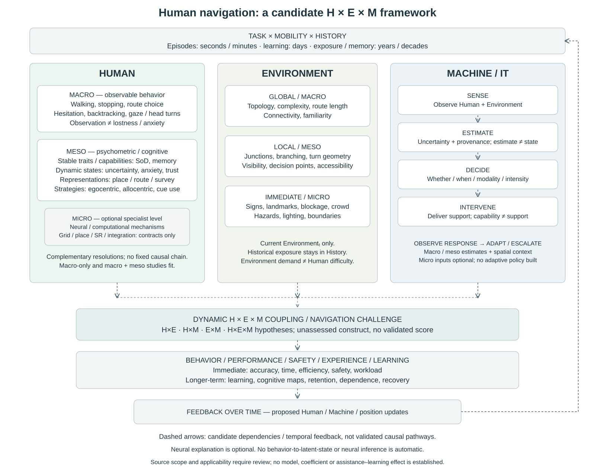
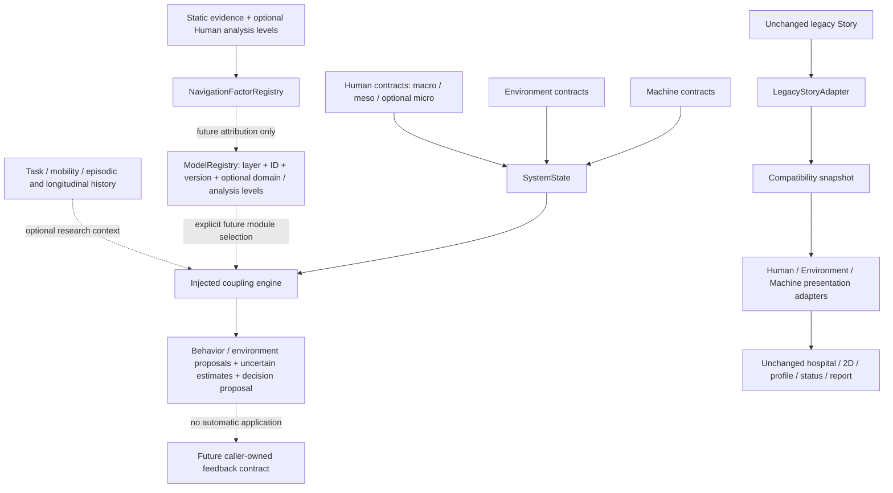

# HME navigation architecture — Nature-informed refinement of V2.2-A

Branch: `v2.2-a-hme-architecture`. Base for the Human-resolution refinement:
`4135e0a94888fc11309e8371587cf0efb5bc4a83` (previous task completed and pushed).
The public main baseline remains `0fe841ae84c19afe52c19b1c153070cb12c214c4`.
This is architecture, ontology and evidence provenance only. No concrete V2.2-B
human model, V2.3 intervention policy, merge, V2 checkpoint or production change.

**Evidence boundary:** all eight bibliographic entries and their conceptual scopes
were supplied by the project owner. Nature, DOI.org and Crossref access returned
403 in this environment; abstracts/full texts were not independently accessed.
Source-linked concepts are provisional mappings, not verified operationalizations
or validated predictors. S8 has no supplied DOI; none is invented. The detailed
[evidence audit](NATURE_NAVIGATION_EVIDENCE.md) distinguishes each source’s supplied
scope, limitations and implications.

## Figure A — scientific conceptual framework (Figure 1)



This is an early theoretical figure, separate from software structure. Dashed
arrows indicate candidate dependencies and temporal ordering, **not established
causal effects**. The accompanying S1–S8 bibliography supplies conceptual context,
not validation of this framework. The framework asks how Human × Environment × Machine × Task/Mobility ×
History could jointly shape navigation. It does not implement `Outcome = H + E + M`,
a universal weighted score, an answer to an interaction question, or an effect size.

Human distal determinants, capabilities, representations/strategies, latent states,
and observable actions remain separate. Environment history is distinct from
current global context, local conditions at t, and immediate cues/events at t.
Technology as exposure is distinct from the machine’s observation/action loop.
Behavior, performance, safety, memory and subjective outcomes are distinct from
proposed updates to Human state, policy and position at t+1.

## Human: three nested scientific resolutions

Human navigation is studied at three nested resolutions:
macro behavioral,
meso psychometric/cognitive,
and micro neural/computational.

These levels are complementary rather than hierarchical in scientific validity.
Neural-computational explanation is optional, not required for behavioral or psychometric studies.

All three levels belong inside **Human**. Micro is its finest resolution, not the
central theory of HME. A macro-only study or macro + meso study is complete without
neural data. The earlier determinants/traits/states/strategies/behavior taxonomy
continues to apply within this resolution scheme; historical determinants are
cross-cutting background, not a fourth analysis level.

| Human resolution | Scientific content | Boundary |
| --- | --- | --- |
| Macro observable behavior | Walking/speed, acceleration/deceleration, stopping/pause duration, hesitation, route choice/deviation, wrong turns, backtracking/detours, path tortuosity, turn execution, head/body rotation, gaze/scanning, reorientation, device checking, help seeking | A kinematic marker does not automatically measure lostness or anxiety |
| Meso psychometric/cognitive | Stable SoD, anxiety trait, memory, navigation experience, cognitive/mobility capability, technology familiarity, vulnerability; dynamic uncertainty, lostness/disorientation, anxiety, confidence, workload, attention, fatigue, trust, orientation; place/route/survey knowledge and ego-/allocentric, landmark/geometry/route strategies | Traits, states and representations/strategies retain distinct contracts; a Machine estimate is not a Human latent state |
| Micro neural/computational (optional) | Grid/place-cell-like representations, successor representations, predictive maps, boundary anchoring, path integration, grid scale/orientation/regularity, coding distortion, decoding error, neural uncertainty, Bayesian/precision-weighted integration | Specialist vocabulary and optional description types only; no model, neural data or mandatory explanatory theory |

`HumanAnalysisLevel` uses `macro-behavior`, `meso-psychometric-cognitive`, and
`micro-neural-computational`. `HumanAnalysisRecord` is discriminated by level;
`NeuralComputationalDescription` cannot substitute for psychological states or
behavior observations. Psychological path-integration strategy at meso is distinct
from a proposed computational implementation at micro.

`CrossLevelHumanHypothesis` supports top-down, bottom-up inference, reciprocal
relationships and competing mechanism IDs. For example, a *possible* map-distortion
→ uncertainty → hesitation/backtracking → performance pathway is a research question,
not an encoded causal chain. Reverse inference from hesitation cannot establish
a particular neural mechanism. No cross-level inference executes in this stage.

### Future project-paper examples (illustrative, not existing evidence)

| Possible research paper / model | Human levels | Other context / evaluation |
| --- | --- | --- |
| LostnessBehaviorModel using movement markers | Macro | Test marker validity against separately collected references; its name does not make lostness observed |
| SenseOfDirectionModel / SpatialAnxietyModel | Meso | Use reviewed psychometrics and explicit task/population applicability |
| Navigation-assistance study with movement and questionnaire data | Macro + meso | H×E×M intervention timing/modality; immediate safety and longer-term learning evaluated separately |
| GridRepresentationModel / SuccessorRepresentationModel | Micro (optional) | Specialist neural/computational operationalization and evidence required |
| Competing mechanisms for uncertainty and backtracking | Micro + meso + macro | Compare hypotheses; no causal pathway or empirical result assumed |

### Alignment across domains

Environment retains **global/macro**, **local/meso**, **immediate/micro** spatial
scales. Global covers indoor/outdoor topology, structural complexity, connectivity,
route length and familiarity. Local covers junctions/branching/turn geometry,
visibility, decision points and accessibility. Immediate covers visible
signs/landmarks, blockage/ambiguity, crowd/hazards, lighting and doorway/boundary.
These spatial resolutions are not Human analysis levels. Historical environmental
exposure stays in longitudinal History, separate from current EnvironmentState.

Machine / IT follows **sense → estimate → decide → intervene → observe response
→ adapt/escalate**. Inputs can be macro observations, meso state estimates and
global/local/immediate environmental context. Micro signals are optional.
`MachineResearchInputs` declares possible research inputs only, without changing
policy execution. Environmental demand is not Human difficulty, Machine support
is not Human capability, and navigation outcome is not behavior.

### Research programmes and outcome horizons

- **Human:** who encounters difficulty and why? Study traits, states, behavior and optional mechanisms.
- **Environment:** which spatial/information properties change demand? Study scale, geometry, cues, salience and time pressure.
- **Machine / IT:** how should sensing, estimation and intervention timing/modality/intensity/escalation support navigation?
- **H×E×M:** which intervention works for which person, in which environment, at which moment?

`ResearchNavigationOutcome` discriminates immediate accuracy/time/path length/
efficiency/safety/workload from longer-term learning, cognitive-map formation,
skill retention, technology dependence and recovery after technology failure.
Episode and longitudinal windows remain distinct. More assistance may help, harm
or leave learning unchanged; this is an empirical question, not a coded assumption.
Dynamic Navigation Challenge remains unassessed with no validated numerical score.

### Analysis metadata and registry

Optional `ModelMetadata.analysis` declares a scientific `domain` (human,
environment, machine, coupling), one or more `analysisLevels`, and optionally
`humanAnalysisLevels`. The analysis vocabulary includes behavioral,
psychometric-cognitive, neural-computational, environmental-global/local/immediate,
and machine-sensing/estimation/policy/intervention. A model may span multiple
levels. Existing registrations need no new fields. Runtime namespaces still use
human/environment/machine/estimator; estimator maps to scientific Machine.
Coupling is scientific organization metadata, not a new executable registry port.
Validation rejects invalid or inconsistent declared levels without selecting or
executing models or endorsing empirical validity.

Sources, factor definitions and attributions may optionally declare
`humanAnalysisLevels`. Absence means **undeclared**, never all levels. Existing
behavior factors explicitly classify as macro, and navigation traits, states,
representations and strategies as meso. Other factors remain unclassified where
resolution would be ambiguous. No cited paper inherits a factor's classification;
all eight existing sources remain level-undeclared pending claim-specific content
review. A single reviewed source may later declare multiple levels with an explicit
scope. Classification is not an evidence upgrade: no psychometric construct or
neural mechanism follows from behavior alone. The 233-factor evidence statuses,
source verification limitations and zero empirical implementations are unchanged.

## Scientific Human taxonomy

| Category | Structural fields / boundary |
| --- | --- |
| Distal/lifetime determinants | Genetics, ageing, physical/cultural/social exposure-history references, developmental navigation exposure, upbringing, long-term navigation experience |
| Lifestyle/current exposure | Sleep, exercise, current environmental exposure references, technology-use history, navigation frequency, mobility habits |
| Personal attributes/capabilities | Age group, physical/mobility/sensory/cognitive capability, social attributes, vulnerability |
| Navigation traits | SoD, spatial memory ability, spatial anxiety trait, navigation experience, technology familiarity |
| Representations/strategies | Place/route/survey knowledge, egocentric/allocentric representation, path integration, landmark/geometry/route/map-survey strategies |
| Dynamic latent states | Uncertainty, lostness, current anxiety, workload, attention, fatigue, confidence, trust, orientation |
| Observable behaviors | Movement/speed/acceleration, stopping/pause duration, hesitation, body/head rotation, gaze/scanning, reorientation, turns/errors/deviation/backtracking/detours/tortuosity, phone/help/route choice |
| Outcomes | Destination/pointing accuracy, route efficiency, time/length, errors, memory/cognitive-map fidelity, safety, intervention requirement, subjective experience |

`HumanDeterminants` is a nested scientific taxonomy. Existing flat `HumanTraits`
remain a compatibility view, not a competing scientific model. No numeric SoD,
anxiety, genetics, capability or memory scores are generated. Unsupported fields
remain unknown/unpopulated.

`NavigationRepresentations` is independently discriminated and indexed by human,
environment, task and episode window. It allows changing or mixed strategies for
the same person/context over time. A strategy is not permanently assigned as a
trait and is not inferred from a head turn. Same-person/different-strategy outcomes
are representable future questions, not simulated effects.

`HumanStates` represents conceptual internal state; this does not claim access to
its ground truth. Machine estimates have `kind: machine-estimate`, target/variable,
uncertainty and provenance and **cannot be substituted for HumanStates**. Behavior
observation, conceptual latent state, machine estimate and outcome are four
separate types. No observed pause/scanning/backtracking is labelled lostness unless
a future explicitly supplied estimation model justifies that inference.

Behavior records support sequence IDs, episode-relative timestamps, durations,
magnitudes/units and links to environmental events (junction, ambiguous region,
blockage, landmark/sign, boundary). A `NavigationOutcome` is separate and carries a
factor reference and evidence-valued measurement. No new outcomes are populated
in the Showcase; existing scripted A/B/C outcomes and report remain intact.

## Multi-scale Environment and historical exposure

- **Historical exposure:** canonical environmental records in longitudinal History,
  identified by human, time window, exposure category and spatial scope. They can
  describe upbringing, historical streets, cultural/geographical exposure and
  environmental diversity. Human history references them; they are not fields of
  current `EnvironmentState`.
- **Global/macro:** setting/venue, topology, entropy, structural/route complexity,
  connectivity/regularity, visibility, route length and familiarity.
- **Local/meso at t:** upcoming junction, choices/branching, turns/corridors,
  visibility, decision points, accessibility and route segments.
- **Immediate/micro at t:** visible sign/landmark, occlusion, blockage, crowd ahead,
  illumination, hazard, doorway/boundary and visual ambiguity.

Every ontology factor declares temporal and spatial scale, including explicit
`not-applicable` where appropriate. `MultiScaleEnvironment` has separate global,
local-window and immediate-window records. Geometry contracts cover boundaries,
enclosure, regular/distorted layouts, corridor width, narrow/broad regions, turns,
symmetry and irregularity, without Bellmund-derived equations.

Cue groups are independent: geometric (boundaries/shape/orientation/intersections),
landmark (availability/distinctiveness/stability/visibility/salience), wayfinding
(signs/maps/arrows/density/consistency), and visual context
(similarity/salience/clutter/distinctiveness/visibility/reliability). No shared cue
score or validated predictor is assumed. Neural context reliability is not visual
salience and no conversion is supplied.

Situational context retains external time pressure, emergency, crowds, noise,
lighting, weather, blockage/hazards and adds task urgency, destination importance
and instability. Anxiety remains Human state/trait, not an alias of time pressure.
Geometric coordinates in the legacy graph remain schematic units, not calibrated
physical measurements. Global/local complexity and salience remain unimplemented.

## Machine / IT: exposure versus adaptive support

**Role A — technology as exposure:** canonical longitudinal technology records
include aid type, use frequency and active/passive engagement. Human lifestyle and
Machine may reference the same history IDs. No GPS/navigation-aid effect direction,
benefit, harm or magnitude is asserted.

**Role B — adaptive-system contracts:** sense Human/Environment → estimate → decide
→ intervene → observe response → adapt/escalate. Platforms and sensing support
phone/watch/vehicle/AR/robot/kiosk/ambient systems and GPS/IMU/camera/BLE/UWB/gaze/
physiology/vehicle signals. Human and Environment estimates are separately targeted.

Every `StateEstimate` now requires explicit uncertainty and provenance. Missing
uncertainty is `unknown`, not zero or fabricated confidence. The state-estimation
port returns `humanEstimates` rather than a supposedly true `HumanStates` object.
The default estimator emits unknown estimates and never modifies conceptual
Human state. Existing scripted diagnostic values acquire these annotations only;
their numbers and the visible Showcase are unchanged.

`AdaptiveMachineContract` specifies whether/timing/threshold/modality/intensity/
frequency/escalation, and the vocabulary continue/modify/increase/decrease/switch/
escalate/stop. This is a type contract only. No adaptive policy, delivery system,
GPS effect, smartwatch vibration benefit or cue selection is implemented.

## Task / mobility / temporal history

Mobility supports walking, driving, cycling, wheelchair, transit, imagined
navigation and stationary route planning. It is separate from Machine platform.
Navigation tasks include route following, free wayfinding, search, pointing, map
learning, route learning, return, imagined navigation and memory retrieval.
A mobility mode does not fix task type or a person’s strategy.

Two temporal stores are explicit:

| Store | Scale / contents |
| --- | --- |
| Episode | Seconds/minutes/hours; episode ID, behavior/event sequences, route outcomes |
| Longitudinal | Days/months/years/decades/development/lifetime; age/calendar/study references, environmental and technology exposure, learning/memory |

`EpisodeWindow` cannot be assigned to `LongitudinalWindow`. Lifetime exposure is
not collapsed into a transient state vector. Current `SystemState.time` remains
the local simulation clock; existing `CouplingContext.history` holds legacy
snapshots, while optional `research.history` holds these distinct scientific
histories. Clock suspension and avatar freezing remain independent.

`TemporalFeedbackProposal` references an interaction, behavior/outcomes and proposed
Human states / policy / position at t+1. It does not apply, schedule or learn a
transition. Outcome/adaptation arrays from the current composition engine remain
unevaluated/empty; absence of a proposal is not evidence of safety or no need.

## Interaction hypotheses and person–environment challenge

`InteractionHypothesis` explicitly represents H×E, H×M, E×M and H×E×M participants,
versioned-factor references, a question and conditioning task/mobility/history
context. Static [example questions](showcase-web/engine/navigationHypotheses.ts)
ask about SoD × complexity, SoD × cue, clutter × vibration, and person/state ×
junction × intervention timing. They contain no answers, coefficients or policies.

`NavigationChallenge` links capability/state factors to environmental demand and
machine support at a spatial scope. Its assessment is `unassessed`; it has no
numeric mismatch score or validated-theory status. Person–environment matching
is a future hypothesis, not a deterministic inference from upbringing/topology.

## Evidence ontology and provenance

The [machine-readable evidence map](showcase-web/models/evidence/navigationEvidence.ts)
contains **233 versioned factors**. The [complete audit index](docs/navigation-factor-index.md)
shows every layer/category, observability, scale, source and implementation status.
The current distribution is 57 source-linked concepts, 149 framework placeholders,
and 27 synthetic/legacy entries. **Zero** are labelled independently verified
`direct-source-support` and zero have empirical model implementations.

A source’s publication class is separate from a factor’s support status, its
implementation and applicability. The eight evidence classes support Nature
review/primary/Portfolio, project/external empirical, hypothesis, synthetic and
unknown. Source metadata includes verification status; unknown citations do not
get invented. `ScientificAttribution` can attach factor/source references and
claim scope to future values/models without forcing Nature citations onto every
structural placeholder.

`NavigationFactorRegistry` validates unique ID/version, layer, observability,
scales, source/DOI format, source references and scope. It stores immutable copies,
rejects unsupported Nature classifications and prevents promoting unaccessed
sources to direct verified support. Registry validation is **not** paper
verification, causal validation, or evidence of transportability.

Factor records include population/task/mobility applicability, exclusions, model
reference/version and implementation status. Empty applicability means
unestablished. `LEGACY_FACTOR_BINDINGS` and `LEGACY_DIAGNOSTIC_BINDINGS` audit the
previous fields. SoD, anxiety, time pressure, signage, landmark salience and
smartwatch/vibration interventions are explicitly **not** labelled validated
Nature/NHB predictors by this source set. No project empirical paper is invented.

## Figure B — software implementation architecture



The scientific Figure A describes candidate constructs/dependencies. Figure B
describes code contracts and data flow. Neither establishes causal effects.
The evidence ontology does **not** control current Story or public presentation.
It is not imported into the public runtime; source URLs are inert static metadata.

`createCouplingEngine` composes injected Environment, Human, estimation and Machine
ports. Optional research context supplies interactions/task/history/challenge
contracts. Machine-estimation outputs are explicitly separate from conceptual
Human state; outputs remain proposals and never advance the clock or select A/B/C.
Registry registration does not automatically execute or validate a module.

## Legacy compatibility and protected behavior

`LegacyStoryAdapter` still maps RESIDENTS, NODES/EDGES, authoritative factors/assess,
scripted sensing and A/B/C responses into a snapshot. No triage formula or timing
is copied into the evidence framework. The sole runtime data addition is explicit
estimate kind/unknown uncertainty/provenance, which presentation does not consume.
Optional scientific profiles/context/histories/outcomes are not populated.

The existing 3D and 2D views share the identical Story object. R01–R08, R06/walker,
green→amber→red, emerging backtracks, blocked East Exit, human gate, A/B/C,
40/39/1/97.5% and scientific caveats are preserved. `story.ts` stays byte-identical
to V1. Flat legacy profile fields and all historical screenshots remain intact.

The previous three illustrative configurations remain data only: older adult in
hospital with proposed phone cues; adult driver/road/vehicle navigation; wheelchair
user/public building/accessible guidance. Their requested models are unimplemented.
They establish no effect of SoD, anxiety, complexity, phone/watch cues or driving.

## Source tree and future replacement

```text
models/
  human/{types,defaults,humanModel,navigationScience,outcomes,analysisLevels,multilevel}.ts
  environment/{types,defaults,environmentModel,navigationScience}.ts
  machine/{types,defaults,interventionPolicy,navigationScience}.ts
  analysisMetadata.ts
  mobility/types.ts
  navigation/{scales,task,history}.ts
  evidence/{types,scientificSources,navigationEvidence,navigationFactorRegistry}.ts
engine/
  simulationState.ts / couplingEngine.ts / stateEstimator.ts / modelRegistry.ts
  navigationResearch.ts / navigationHypotheses.ts
compatibility/legacyStoryAdapter.ts / legacyModels.ts
presentation/adapters/{human,environment,machine}Presentation.ts
```

Future studies may explicitly register versioned model implementations with
reviewed source/operationalization/applicability information, then inject them.
No scientific paper is automatically converted into a model or a public UI factor.
No SoD/anxiety equation, lostness CNN-BiLSTM, complexity/entropy/salience/grid-cell
algorithm, adaptive policy, neural runtime or intervention effect is implemented.

> The Human–Machine–Environment architecture defines modular interfaces for
> integrating future empirical models. The architecture itself does not establish
> the validity of any specific human, environmental, or intervention model.

3D behavior remains scripted, not an empirically validated human navigation model;
97.5% remains a scripted prototype result, not a real-world automation estimate.

## Verification and review

Run `npm install`, `npm run typecheck`, `npm run test`, `npm run build`, both
`npm run test:browser` and `npm run test:browser:3d`, plus the root Python regression
suite. Browser scripts use a freshly built production server; approved screenshots
are preserved separately from regenerated QA images. No Vercel settings change.
Stop for human **scientific** review on the same branch. Do not merge, modify V1,
create V2 tags, start concrete V2.2-B models, or implement V2.3 intervention.

Verified for this refinement: installation, TypeScript, **41 frontend tests**,
production build, both real-browser suites (retained V1/2D and 3D), and **32 Python
regressions** pass. Browser checks cover all eight residents, cameras, emerging
hesitation/backtracking, crisis/block/freeze, A/85 safe West arrival, B unsafe/C
refuge, unchanged report values, mobile/reduced motion/reset/fallback, and no
browser errors or external runtime requests. Source-content verification is
**not** included in these passing software checks; publisher/DOI/Crossref access
was blocked as documented above.
