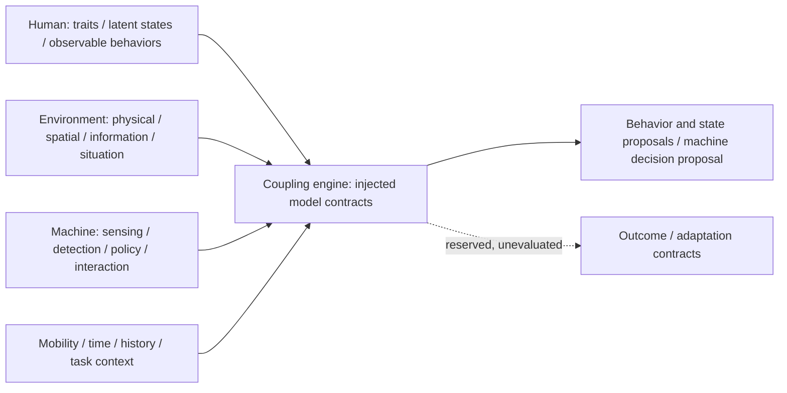
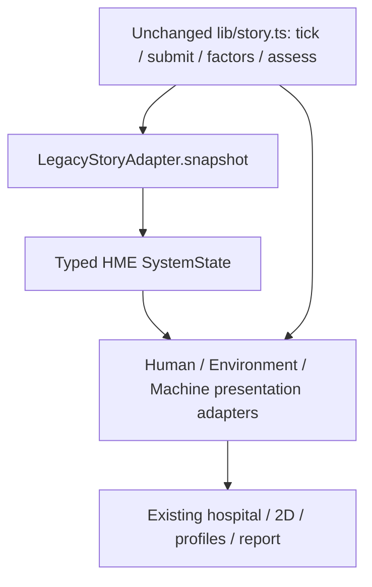

# V2.2-A — Human–Machine–Environment core architecture

Review branch: `v2.2-a-hme-architecture`.
Exact base: `0fe841ae84c19afe52c19b1c153070cb12c214c4`.
This is a structural research framework, not a new scientific model, V2 stable
checkpoint, or V2.3 adaptive-intervention implementation. Main and production
remain unchanged until human review and a separately approved merge.

## 1. Conceptual overview

Human, Environment, and Machine/IT are distinct domains. Explicit interfaces and
a coupling engine provide composition; there is no universal weighted HME score.



`SystemState` is a readonly aggregate of a population (`humans`), an environment,
a machine loop, per-human mobility modes, time, and study/task context. IDs,
venues, graphs, sensors, and population size are not restricted to R06/hospitals.
Unknown evidence has an explicit `kind: 'unknown'`; it is not zero or a fabricated
score. Known values carry provenance and optional scale/citation information.
Qualitative `low` / `moderate` / `high` configuration labels imply no numerical
scale or model output. Numeric empirical integrations must identify their scale.

## 2. Human layer

- `HumanTraits`: relatively stable age group, Sense of Direction, spatial memory,
  spatial anxiety trait, cognitive/mobility capability, technology familiarity,
  navigation experience, vulnerability, and namespaced extensions.
- `HumanStates`: latent lostness, navigation uncertainty, current spatial anxiety,
  cognitive workload, fatigue, attention, confidence, and trust.
- `HumanBehaviors`: timestamped observable actions with provenance, optionally a
  magnitude and unit. Vocabulary includes walking, stopping, speed, turning,
  head turning, looking around, hesitation, backtracking, wrong turns, detours,
  body rotation, phone checking, and asking for help.
- `HumanProfile` and `HumanSnapshot` keep identity/traits separate from states and
  behaviors. Their discriminants prevent assigning traits to states/behaviors.
- `HumanModel.evaluateHumanBehavior(CouplingContext)` is replaceable.

The legacy adapter declares age, walker/walking label and prototype vulnerability
from the existing script. It does **not** invent SoD, anxiety, memory or capability
scores. Animated walking/stopping/head scans are labelled scripted observations,
not real human measurements. All latent states remain unknown. In particular,
legacy machine navigation-confidence factors do not become measured human trust,
confidence, lostness or anxiety.

## 3. Environment layer

`EnvironmentState` contains four explicit categories:

| Category | Fields / intended scope |
| --- | --- |
| `PhysicalContext` | Indoor/outdoor/mixed setting, venue, familiarity |
| `SpatialStructure` | Coordinate system, nodes/edges, global/local complexity, turns/angles, branching, connectivity, visibility, route length, accessibility constraints |
| `InformationEnvironment` | Signage, wayfinding system, landmark salience/distinctiveness, feature similarity, visual salience/clutter, information density |
| `SituationalContext` | External time pressure, emergency, crowds, noise, lighting, weather, blockages, hazards |

Time pressure is an external task/context constraint, never a Human trait. The
legacy scene's seconds are scripted playback time, not a time-pressure measure.
The node graph is in **schematic units**, not empirically measured metres.
Graph topology and the scripted East blockage are supplied; no graph-derived
complexity, landmark salience, crowd density, or hazard algorithm is implemented.
`EnvironmentModel.evaluateEnvironment` supplies the replacement port.

## 4. Machine / IT layer

The Machine domain represents a loop, not just a device label:

**Sense Human + Environment → detect/estimate → decide → select intervention
(timing/modality/intensity/frequency) → interact → observe response → repeat or
escalate.**

Types cover smartphone, smartwatch, vehicle system, AR glasses, robot, kiosk and
ambient building platforms; GPS/IMU/camera/BLE/UWB/gaze/physiology/vehicle sensing;
separate Human and Environment state estimates; policy decision; intervention;
and operator response / feedback / interaction phase. History provides the port
for future observation of human responses. `MachinePolicy` can receive all model
evaluations and machine capabilities through the coupling contract.

Intervention modalities include map, arrow, text, voice, vibration, landmark cue,
AR overlay, dialogue, confirmation, feedback, and human takeover. Unknown timing,
intensity/frequency values are not replaced with synthetic numeric defaults.
No modality delivery system or adaptive intervention algorithm is implemented.

Named `PrototypeDiagnostic` records contain the existing Story triage inputs,
score and fired rules. They are **legacy machine diagnostics**, not a single score
for all HME layers. `PrototypePolicy` exposes the existing Story/operator decision;
it cannot choose A/B/C on behalf of the viewer.

## 5. Mobility / task mode

`MobilityMode` supports walking (including walker/cane), driving with a vehicle
reference, cycling, wheelchair, public transit, and explicit named future modes.
Assignments are keyed by human ID and available through `CouplingContext.system`.
Walking is behavior/mobility, not a Machine platform. Driving combines a human,
a driving task mode, vehicle/platform capabilities, and road context. No
driving-specific behavioral equation is added.

## 6. Coupling engine and state estimation

`createCouplingEngine({human, environment, estimator, machine})` injects four
versioned interfaces. `evaluate({system, history})` calls:

1. `EnvironmentModel.evaluateEnvironment(context)`
2. `HumanModel.evaluateHumanBehavior(context)`
3. `StateEstimator.evaluateHumanState(behaviors, context)`
4. `MachinePolicy.selectMachineIntervention(context, evaluations)`

It returns proposals. It does not mutate inputs, advance time, calculate a new
scientific score, infer missing human states, apply interventions, or commit a
model proposal to the system. Environment and state proposals are passed
explicitly to policy; they are not silently applied to input state. Outcome and
adaptation contracts are reserved and return empty arrays in this stage, meaning
**unevaluated**, not confirmed success or no adaptation needed.

Optional legacy pass-through modules expose already supplied behavior/environment
and retain unknown states/Story decisions. They implement no trait-to-behavior or
behavior-to-lostness science. The current Showcase does not run this new engine
to make decisions; state/time ownership remains with the existing Story engine.

## 7. Current V2.1 compatibility and presentation



| Existing source | HME mapping |
| --- | --- |
| `RESIDENTS` | Human IDs, declared age/mobility, prototype vulnerability; per-person walking/walker mode |
| Existing avatar choreography | Script-labelled walking/stopping and looking-around observations; no inferred latent state |
| `NODES` / `EDGES` | Copied spatial graph; original identities and schematic coordinates |
| `blocked(story)` | Environment blockage / hazard evidence; existing timing |
| `factors` / `assess` | Named machine diagnostics and synthetic navigation-confidence estimates; delegated without copying equations |
| UWB / camera / BLE crisis evidence | Script-labelled sensing readings, unknown before supplied crisis evidence |
| Existing human gate and A/B/C | Machine interaction/options/operator response and legacy policy projection |
| Story elapsed / clock guard | System clock snapshot; no second timeline; motion freeze recorded separately |
| Existing observation ledger | Compatibility accounting, unchanged 40/39/1 and 97.5% scripted coverage |

`app/page.tsx` memoizes one legacy snapshot per Story update. Human profile and
Machine status/report views consume presentation read models; scoring/coverage
arithmetic is absent from UI components. The Environment adapter forwards the
**identical Story object** to existing 3D/2D renderers. Legacy route labels,
nearest-location and visual status decisions remain delegated to the existing
functions. No scientific implementation is rewritten or duplicated in renderers.

Clock suspension is deliberately distinct from avatar motion freezing. The
legacy intro/crisis/result clock may advance while bodies stay still;
`time.paused` describes the clock guard, while
`context.extensions.legacyMotionFrozen` records the visual freeze independently.

The separate `sourceStory` reference and accounting are confined to
`LegacyShowcaseSnapshot`, outside the generic domain `SystemState`.
`story.ts`, scientific Python sources, 3D art, clocks, sensor values, thresholds,
evidence cards, A/B/C outcomes and historical screenshots are preserved.

## 8. Model replacement and registry

`ModelRegistry` uses explicit **layer + ID + version** lookup, with typed Human,
Environment, Machine-policy and state-estimator namespaces. Registration rejects
wrong layers, blank IDs/versions and duplicate versions. A missing lookup returns
`undefined`; there is no silent fallback or automatic discovery. Multiple
versions can coexist for deliberate comparison. Registering a module does not run
it, establish validity, or activate it in the Showcase.

For example, a future module can implement `HumanModel`, declare a version and
citation, register as `registry.register('human', model)`, and be explicitly
injected with `registry.get('human', id, version)`. Models share typed coupling
context and history; they do not import renderer components. A future caller must
explicitly own any application of output proposals.

Possible future names (contracts only, no scientific internals installed):
SenseOfDirectionModel, SpatialAnxietyModel, LostnessDetectionModel,
GlobalComplexityModel, LocalComplexityModel, LandmarkSalienceModel, SignageModel,
SmartphoneInterventionPolicy, WearableCuePolicy, AdaptiveEscalationPolicy.
Registry `evidence` metadata is a provenance declaration, not an empirical
certification or claim of transportability between studies.

## 9. Scientific boundaries

> The Human–Machine–Environment architecture defines modular interfaces for
> integrating future empirical models. The architecture itself does not establish
> the validity of any specific human, environmental, or intervention model.

Interfaces are structural. Current supplied modules are prototype/pass-through
or structural placeholders. Future papers/algorithms can replace individual
modules, but architecture alone establishes no causal validity. There is no real
SoD/anxiety model, lostness CNN-BiLSTM, complexity/salience algorithm, adaptive
smartphone/watch policy, or driving behavioral algorithm in this change.

The existing caveats remain: 3D avatar behavior is scripted, not an empirically
validated model of human navigation; **97.5% is a scripted prototype result, not
a real-world automation estimate**. No real human evidence, validated hybrid
superiority, API inference, Argon/Gemini runtime or backend is introduced.

## 10. Three future research integration examples

Executable **configuration data**, not runnable scientific models, is provided in
`showcase-web/models/exampleConfigurations.ts`. It is not imported by the public
Showcase. All requested future modules are marked `not-implemented`, all machine
interventions start as `null`, and latent states remain unknown.

| Example | Human | Environment | Machine / intended future study | Mobility |
| --- | --- | --- | --- | --- |
| A | Older adult; low configured SoD; high configured spatial anxiety trait | Indoor hospital; high local complexity; low landmark salience; high external time pressure | Smartphone, IMU + BLE, arrow + vibration; adaptive intervention **not implemented** | Walking |
| B | Adult driver; moderate configured SoD | Outdoor road network; high intersection complexity | In-vehicle navigation, GPS + camera, voice; no driving algorithm | Driving |
| C | Wheelchair user | Large public building; step-free constraints; inconsistent signage | Smartphone + building system; accessible route guidance interface only | Wheelchair |

A future SoD paper could supply a calibrated trait/behavior module with explicit
scale and citation for A without changing environment or renderer code. A future
intersection-complexity paper could replace only B's Environment module. A future
accessibility study could supply C's route-policy module, retaining Human and
building contracts. These are integration examples, not claims that such effects
or transfer between mobility modes have been demonstrated here.

## Source tree and verification

```text
showcase-web/
  models/
    shared.ts
    exampleConfigurations.ts
    human/{types.ts,defaults.ts,humanModel.ts}
    environment/{types.ts,defaults.ts,environmentModel.ts}
    machine/{types.ts,defaults.ts,interventionPolicy.ts}
    mobility/types.ts
  engine/
    simulationState.ts
    couplingEngine.ts
    stateEstimator.ts
    modelRegistry.ts
  compatibility/
    legacyStoryAdapter.ts
    legacyModels.ts
  presentation/adapters/
    humanPresentation.ts
    environmentPresentation.ts
    machinePresentation.ts
  tests/hme-architecture.test.ts
```

Related types are grouped within each domain instead of creating one file per
example attribute. Default factories create structural unknowns, not scientific
population or policy models. No new runtime dependencies are required.

Required checks: `npm install`, `npm run typecheck`, `npm run test`,
`npm run build`, `npm run test:browser`, `npm run test:browser:3d`, and from the
repository root `python -m unittest discover -v` using its configured Python
environment. Set `SHOWCASE_URL` to the freshly built local production server.
For retained 2D checks, `UPDATE_SCREENSHOTS=0` keeps historical images intact;
the 3D script regenerates its screenshots, which should be preserved as separate
QA evidence and restored to approved bytes before this architecture commit.

Architecture tests include negative compile-time category/registry assignments,
all domain structures, generic configurations, provenance/unknown semantics,
all legacy stages and A/B/C outcomes, frozen snapshots, registry lookup/version
errors, injected model orchestration/history, no implicit proposal application,
layer import boundaries and absence of scientific formulas in UI components.

Stop at V2.2-A for human review. Do not merge this branch, create a V2 checkpoint,
modify V1, change production configuration, or begin V2.3 here.

Verified on the review branch (2026-10-14): installation, TypeScript, all **24
frontend tests**, production build, both real-browser suites (3D and retained
V1/2D), and all **32 Python regressions** pass. Browser checks cover eight
persistent avatars, selection/cameras, amber hesitation/backtracking, red crisis
and blocked East Exit, frozen human gate, A/85 West Exit arrival, B unsafe/C refuge,
40/39/1/97.5% reporting, mobile/reduced motion/reset/fallback, and no browser errors
or external runtime requests. Scientific Story source is byte-identical to V1.
