# New Research Paradigm

**Stable checkpoint: [V1](https://github.com/zhoujia07-hash/NewResearchParadigm/tree/V1)**
— commit `8ebddca5ec84b3fc29e789febc800fc5bdc2bdc0`, successfully deployed to Vercel
as confirmed by the project owner. V1 is permanent; future development continues
from `main`. See [checkpoint and rollback instructions](VERSION_CHECKPOINTS.md).

**Standalone Vercel Showcase:** the new [Next.js frontend](showcase-web/README.md)
runs independently in `showcase-web/`, with no Python server or environment variables.
The original Streamlit research platform remains available below.

**Public Showcase → experience the paradigm.** The default landing page is a
minimal guided story: ordinary cases → emerging risk → automatic pause → your
judgment → hybrid recovery. No researcher sliders, sign-in or API key are needed.

**Research Instrument → inspect and configure the paradigm.** Click **Open
Research Instrument** for the preserved Milestone 1–6 workflows. Leaving an
active story pauses it, so returning does not jump ahead. Milestone 7 has **not**
been started.

The standalone Vercel Showcase is deployed at **V1**, as confirmed by the project
owner; its public URL has not been provided here. The separate Streamlit Community
Cloud deployment remains unpublished; its deployment action is below.


**AI High-Throughput Simulation + Human Long-Tail Intervention**

A runnable HCI research instrument for exploring **when AI should stop acting
autonomously and defer a spatial decision to a human**. Ordinary cases are
processed automatically; uncertain/high-risk tails are prioritized for human
judgment and subsequent empirical evaluation.

```text
Large Scenario Space
        ↓
AI High-Throughput Sandbox
        ↓
Automatic Triage
      ↙   ↘
HEAD      LONG TAIL
 ↓            ↓
AUTO        HUMAN
              ↓
        Hybrid Decision
              ↓
        Empirical Evaluation (future approved human studies)
```

**Evidence boundary:** all included scenarios, agent outputs and automated pilot
runs are **SIMULATED EVIDENCE**, not **HUMAN EMPIRICAL EVIDENCE**. The familiar
97.5% automation coverage is the result of one fictional five-round demonstration,
not an estimate of real-world automation. Synthetic agents never substitute for
human participants, and Hybrid > Human is not claimed.

| Milestone | Capability | Current validation |
| --- | --- | --- |
| 1 | Standard-library CLI, asyncio, 8 occupants, selective takeover | A/85 closed loop and JSON report |
| 2 | Five-round visual sandbox, pause/resume, human judgment | A/B/C tests and Chromium interaction |
| 3 | Configurable factors/weights/rules, reproducible sweep and inspector | Default rules, seed, import/export and regression tests |
| 4 | 100–5,000 scenarios, head/tail exploration and study sampling | Four sizes, five strategies, unique condition exports |
| 5 | Five-role Concordia adapter, structured proposals and comparison | Actual Concordia 2.4 lifecycle with mock; real LLM calls untested |
| 6 | Anonymous study builder, three trial conditions, logs and pilot analysis | Automated synthetic pilot; no real human study performed |

**Quick start (Python 3.12+):** create/activate a virtual environment, run
`python -m pip install -r requirements.txt`, then `streamlit run app.py`.
All deterministic, study and no-key mock workflows remain available with this
base installation. Optionally install `requirements-agents.txt` for Concordia.
Showcase opens without a sidebar. Open Research Instrument reveals the five
research workspaces and a route back to Showcase; participant pilots hide
researcher controls. Formal participant deployments are outside the validated scope.


A deterministic research demo of AI throughput with selective human takeover.
The validated command-line baseline is `demo.py`; its scenario and decision
application are reused by the Web Demo. Milestone 3 extracts its unchanged
default scoring and thresholds into the shared `triage.py` module.
No LLM APIs, API keys, Concordia, Redis or Docker are needed.

## Run the Web Demo

From this repository, create an environment and install the single direct dependency:

```bash
python3 -m venv .venv
source .venv/bin/activate
python -m pip install -r requirements.txt
streamlit run app.py
```

From the repository root, activate your prepared virtual environment:

```bash
source .venv/bin/activate
streamlit run app.py
```

Use Streamlit's reported local address in a browser on the same machine.
The cloud chat does not provide a public preview or localhost forwarding.

1. Click **Start automatic simulation** (2-second rounds), or use **Next round**.
2. Observe eight green markers moving on the schematic and the live triage table.
3. Round 3 marks East Exit blocked and R06 red. All advancement pauses.
4. Select A, B or C, set confidence, then click **Submit Human Decision**.
5. Rounds 4–5 resume. A moves R06 through West Corridor to West Exit.
6. Read the final comparison and download `hybrid_web_report.json`.
7. **Reset simulation** begins a new independent session.

A yields safe evacuation; B retains the blocked-exit hazard; C waits at refuge
with staff assistance requested and evacuation unconfirmed. These are scripted
outcomes, not empirical evidence of comparative performance. Human-alone
performance requires empirical testing.

The seven normal round-3 observations wait behind the pause barrier. After
submission they are counted as automatically processed. The final counts match
the CLI: 40 observations, 39 automatic, one escalation, 97.5% coverage.
Follow-up observations under B/C use the previously submitted human instruction
rather than opening a duplicate escalation for the same incident, as in the CLI.

## Validation

```bash
python -m unittest -v test_web.py
```

Streamlit AppTest checks real widgets, A/B/C outcomes, pause guards, automatic
progression render ticks, confidence, reset and final reports. The state engine
uses asyncio to collect eight concurrent observations per round. The SVG building
and ordinary movement paths are illustrative, not a physical evacuation model.
The Web Demo is session-local; reloads can reset it, and reports are retained only
when downloaded. It does not overwrite the CLI's `hybrid_demo_report.json`.

## Command-line baseline

```bash
python3 demo.py
```

This baseline continues to require only the Python standard library.

## Visual Demo Screenshots


## Milestone 3 — Configurable Research Instrument

The research question is: **When should an AI system stop acting autonomously
and defer a spatial decision to a human?** This milestone adds a separate
**Research instrument** workspace in the sidebar. **Five-round demo** still runs
the existing 8-person scenario, pauses in round 3, and completes A/B/C decisions.
The earlier screenshots above document that baseline; they are preserved.

### Research controls and live triage

Use the sidebar to edit resident age/mobility, familiarity, sense of direction,
cognitive vulnerability, navigation confidence, backtracking, hesitation, route
progress, sensor confidence/agreement, agent confidence/disagreement, risk,
complexity, crowd density, blocked exits and emergency context. Seven preset
buttons provide starting points. **Blocked exit crisis** imports the six factor
values from the original R06 scenario and scores **0.8394** with default weights.

The six operative factors are navigation uncertainty (`1 - confidence`), sensor
conflict (`1 - agreement`), model disagreement, behavior anomaly, safety risk and
vulnerability. The default weights remain **0.18, 0.18, 0.18, 0.18, 0.22, 0.06**.
All effective weights are normalized to sum to 1. **Normalize weights** writes
these values back to the sliders; all-zero weights are rejected. The live
contribution chart, table and equation show exactly how the score is calculated.

The main threshold defaults to **0.62**. Mandatory escalation still occurs for
risk ≥ **0.85**, disagreement ≥ **0.75** together with agreement ≤ **0.45**, or
behavior anomaly ≥ **0.80**. All five cutoffs are editable. Each rule is shown
individually, so raising the main threshold does not hide mandatory escalation.
Green means AI AUTO, amber means score ≥ 80% of the main threshold with no
escalation, and red means HUMAN TAKEOVER. Research mode evaluates a live snapshot;
it does not change the baseline round engine or automatically measure human
judgment quality.

**Prototype thresholds — not empirically calibrated.** Verification means that
the implementation matches its specification, not that these settings have
scientific validity.

### Context versus direct factors

Direct-factor mode is the default. Profile/context fields and individual
sensor/agent confidences are descriptive metadata: they do not silently alter
aggregate vulnerability, agreement or disagreement. The sensor-conflict checkbox
shows three different location reports while agreement remains independently
editable. The inspected resident is R06; the other seven markers provide context.

An optional **Enable prototype context-to-factor mapping** checkbox allows
explicit, deterministic stress-test mappings from age, mobility, familiarity,
cognitive vulnerability, hesitation, backtracking, route progress, complexity,
crowds, exit blockage and emergencies to the three effective factors of
vulnerability, behavior anomaly and risk. The exact max/floor formulas are shown
in the UI and `research_config.py`. These mappings are **uncalibrated assumptions**,
not demographic findings. They are off for all presets and when loading a
synthetic case, preserving the case's six factors exactly.

### Threshold sweep and case inspector

Click **Run Threshold Sweep** to generate **500 cases** by default (adjustable
from 200–2000) using local `random.Random(seed)`, default seed **42**. Each case
has six independent uniform [0,1] factor values. The main threshold is evaluated
at **15 points**, from 0.20 through 0.90 in steps of 0.05. The current effective
weights and all mandatory rules apply at every point.

The synthetic benchmark critical label is deliberately transparent:

```text
critical = safety_risk >= 0.80
        OR behavior_anomaly >= 0.85
        OR (model_disagreement >= 0.80 AND sensor_agreement <= 0.35)
```

**Synthetic benchmark ground truth for prototype evaluation only.** It is a
constructed label, not observed human safety data. It is independent of the
researcher's edited escalation settings. Metrics are:

- Automation coverage: automatically handled cases / all cases.
- Human escalation rate: escalated cases / all cases.
- Critical-case recall: escalated critical cases / critical cases.
- Missed critical cases: critical cases handled automatically.
- False escalation rate: escalated noncritical cases / noncritical cases.

Undefined recall or false-escalation denominators are reported as N/A. The
coverage–risk curve plots coverage against recall, with the current threshold
marked in red. The exact current threshold is evaluated even if it falls between
grid points. Mandatory rules can create plateaus. Increasing automation can miss
critical cases; increasing escalation can increase human workload. **No optimal
threshold or superiority claim is implied.**

Filter the **Case Inspector** by True escalation, Safe automation, Missed critical
or False escalation. Choose a case and click **Load selected case into sandbox**.
Its six inputs load into R06's controls and visualization. These outcome names
refer to synthetic classification, not observed evacuation safety outcomes.
Weights/threshold changes update the existing benchmark live; seed/sample-count
changes show a stale-benchmark warning until a new sweep is run.

### Export, import and reproducibility

Download `experiment_config.json` to save all controls, normalized weights,
thresholds, seed and sample count in a versioned schema. Import it using the
sidebar uploader and **Import configuration**. Invalid/nonfinite values, unknown
settings and unsupported schema versions are rejected without partial changes.
Import clears the old benchmark; run a new sweep.

Download `threshold_sweep.csv` for all 15 result rows, seed, weights and mandatory
cutoffs. Download `selected_case.json` for the selected case's original factors,
seed, classification and evaluation settings. Session state is local to the
browser session; these exports are the durable experimental record. There is no
participant database, persistent study log or real LLM/agent service.

Visible scientific cautions throughout the instrument include:

- LLM/synthetic-agent behavior is not treated as a substitute for human behavioral data.
- The synthetic benchmark is used for stress testing and experimental design, not for estimating real human effect sizes.
- Human-alone and Hybrid performance require empirical validation with human participants.

### Launch and validation

For a new machine, install the same single direct dependency, Streamlit:

```bash
python3 -m venv .venv
source .venv/bin/activate
python -m pip install -r requirements.txt
streamlit run app.py
```

Then select **Research instrument** in the sidebar. In the prepared cloud machine,
activate the existing virtual environment as shown in the earlier Run section.
Altair is included among Streamlit's required dependencies; no additional package,
API key, Concordia, Redis or Docker was introduced.

```bash
python -m unittest -v test_web.py
```

The 13 test methods cover the three mandatory escalation rules and boundaries,
normal/R06 scoring, normalization, seed determinism, all 15 sweep points, metric
arithmetic, coverage/recall monotonicity, configuration validation, context-mapping
isolation, inspector loading, the standard-library CLI, and the existing A/B/C
web workflows.

The shared source of truth is now `triage.py`, extracted from the CLI without
changing its default formula. `demo.py` retains the original occupants, crisis,
asyncio workflow, human input and report. `web_simulation.py` retains the round
state; `app.py` selects/render workspaces; `research_ui.py` renders research
controls; `research_config.py` handles presets/schema/mapping; `synthetic_cases.py`
generates cases and sweeps.

Real browser verification is repeatable with `node test_browser.cjs` when
Playwright and Chromium are available (already provided in this cloud runtime).
Start Streamlit first. The browser test checks normal/crisis presets, red and
amber markers, threshold changes, chart rendering, missed-critical filtering,
case loading, JSON/CSV exports, JSON import, and the baseline A/85 round workflow.
It regenerates screenshots 04–06 and stores downloaded test outputs in `/tmp`;
it leaves screenshots 01–03 untouched. Set `CHROMIUM_PATH` or `DEMO_URL` if needed.

At default research settings and seed 42, the synthetic benchmark contains 500
cases. At threshold 0.62 its coverage is **55.6%**, recall **89.8%**, and there are
**20 missed critical cases**. These figures describe this artificial distribution
only; they are not estimates of real human behavior or real-world risk.

### Research instrument screenshots


### Next research milestone

A sensible Milestone 4 is a small human-participant pilot: define task scenarios
and study conditions, add consent/session identifiers and timestamped interaction
logs, counterbalance AI-only/Human-only/Hybrid conditions, and export comparable
human outcomes. Use those data to evaluate decision quality, workload, confidence
and intervention timing before calibrating thresholds or adding real LLM agents.

## Milestone 4 — High-Throughput Digital Sandbox

Choose **High-throughput sandbox**. Generate 100, 500, 1,000 or 5,000 seeded
scenarios varying profile, navigation, sensor/agent confidence and environmental
metadata. Six independently sampled factors feed the unchanged deterministic
triage. Metadata are not hidden causal modifiers. HEAD and WATCH both remain
automatic; LONG-TAIL cases escalate. The dashboard shows percentages, score
histograms, overlapping escalation reasons, descriptive binned factor rates,
coverage/recall frontier, missed/false escalations and interventions per 1,000.

The top-20 ranking is an explicitly exploratory mean of score, disagreement,
risk, sensor conflict and boundary ambiguity. Select a case to replay its
profile and triage state on the existing map. Study sampling includes highest
risk, highest disagreement, nearest main threshold, round-robin reason strata,
and seeded random tail cases. All strategies sample only escalated cases without
replacement. Conditions have deterministic unique IDs; small/empty pools are
reported honestly. JSON/CSV exports retain factors, metadata, seeds, weights,
thresholds and selection strategy. They are prioritization material, not
validated human-study conditions or human evidence.

Verified with 16 automated test methods and a Chromium workflow. Run the full
suite with `python -m unittest discover -v`. `node test_platform_browser.cjs`
verifies the batch UI and study exports when the local Streamlit server is running.

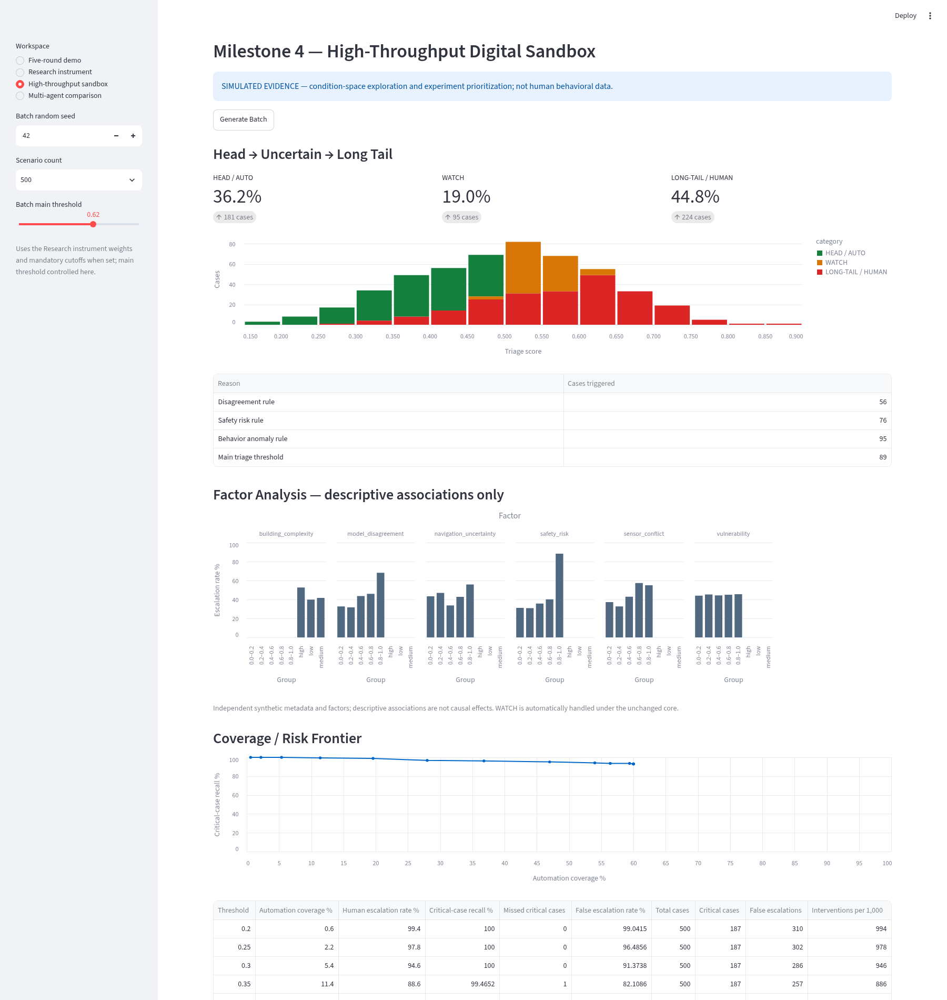

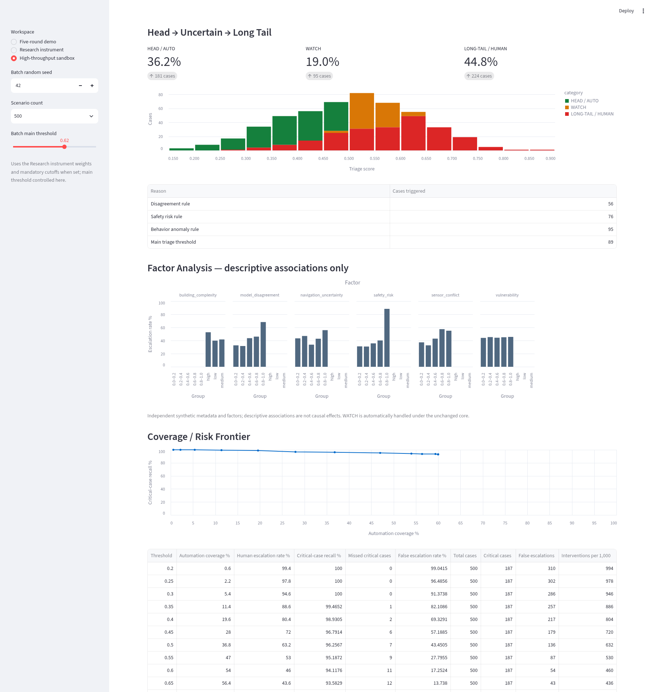

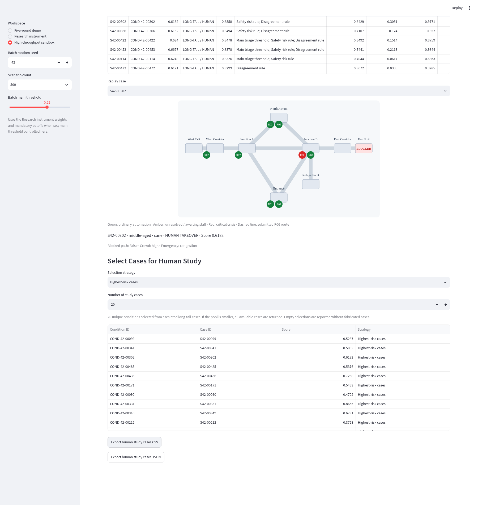

## Milestone 5 — Generative Multi-Agent Integration

Choose **Multi-agent comparison**. Deterministic remains the default; choose
Concordia / LLM and mock to run ResidentAgent, RouteAgent, SafetyAgent,
AccessibilityAgent and GameMaster through the installed Concordia 2.4 EntityAgent
lifecycle. The resident is conditioned by the profile; the environment controller
holds topology and hazards. Mock is a scripted proposal source, not a real LLM.
A validated, optional real-provider seam is available but real provider requests
have not been executed. See [Concordia API and provider setup](agents/CONCORDIA_NOTES.md).

The recommendation matrix exposes choices/confidence/reasons and blocked-route
admissibility. Advisor pairwise route mismatch feeds the unchanged triage engine.
Structured parsing, finite-number clamping, explicit no-key mock fallback and
whole-input deterministic fallback prevent malformed prose from controlling the
experiment. The same scenario's deterministic and agent outputs are compared;
no behavioral validity or superiority is inferred. Optional dependencies are in
`requirements-agents.txt`; `requirements.txt` alone preserves all no-key modes.

Twenty automated test methods plus Chromium verification passed. The verified
blocked-exit mock generated three distinct advisor routes, disagreement 1.0 and
human escalation; baseline R06 scoring remains unchanged in deterministic mode.
**Agent simulation validity must be evaluated against human behavior.**

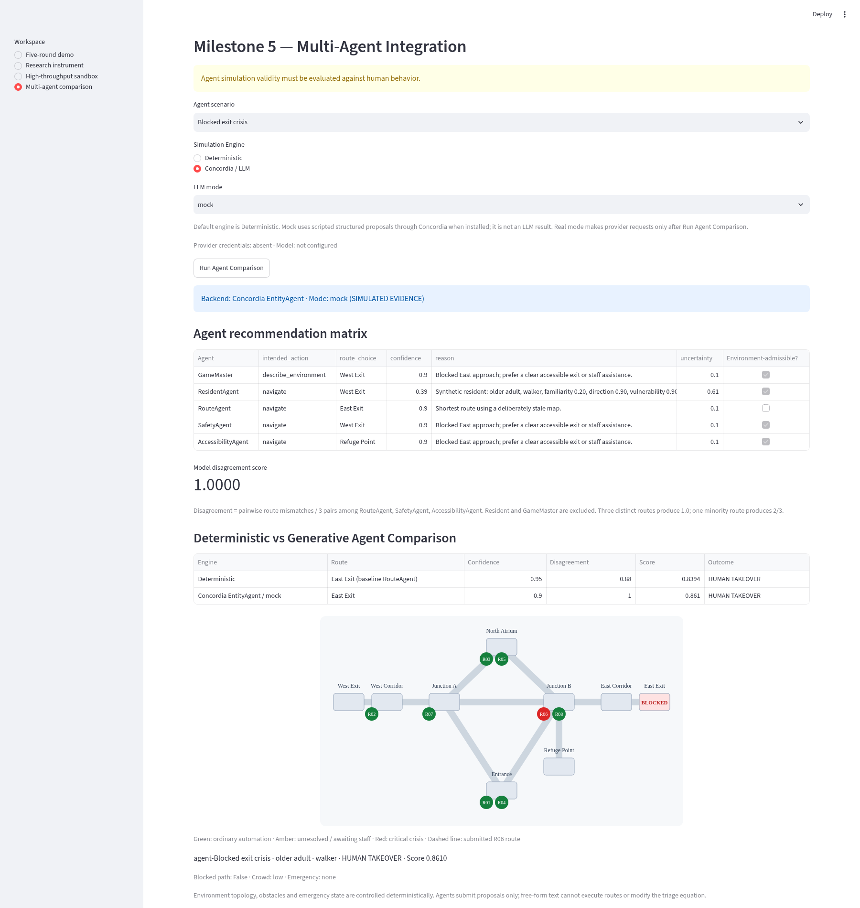

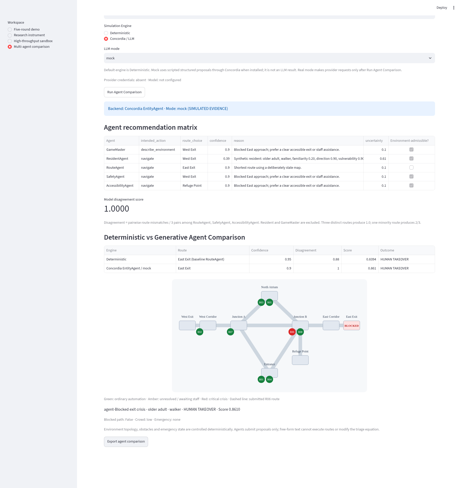

## Milestone 6 — Human Experiment Platform

Choose **Human Study Builder**. Configure trials **per condition** (1–20), case
sampling, AI-only/Human-only/Human + AI selective takeover conditions, five
explanation levels, seed, optional post-trial questions, timer visibility and
Deterministic/Concordia-mock proposal source. Default is one case per condition
(three trials), full explanations, no optional questions, hidden timer.
Generate/export `experiment_protocol.json`, then Launch Pilot Participant.

The builder consumes the current batch study pool, or generates a reproducible
500-case space if no pool exists. Each selected case appears once in each chosen
condition. Case order, per-case condition order and Hybrid explanation assignment
are seeded. Small pools reduce actual trial count rather than inventing cases.
Repeated scenarios enable a paired prototype comparison but can create carryover
and learning effects; this is not a complete counterbalancing design.

The participant interface hides researcher navigation/controls. It progresses
through a consent **placeholder**, instructions, trials and completion. It shows:

- AI-only: the automatic decision, with no fabricated human response or human RT.
- Human-only: map and spatial facts, without AI recommendation/confidence/evidence.
- Hybrid: human judgment only for cases escalated by the unchanged triage engine;
  ordinary cases remain automatic.

Explanation levels are recommendation only, +confidence, +sensor evidence,
+agent disagreement, and full explanation. The trial never reveals the scripted
correct-choice reference. Optional workload, trust, difficulty and usefulness
items are off by default; enabled items remain optional and are not imputed.

**Formal human-subject research requires institutionally approved consent and
ethics procedures.** This prototype collects no names, emails, participant health
information or identifying personal fields. Resident profiles describe fictional
scenarios, not the participant. Anonymous IDs (P001, P002, …) and internal random
session IDs are allocated locally. Browser tests explicitly label their source
`automated_browser_pilot`; software-generated test sessions are `synthetic_pilot`.
Manual demonstrations are `prototype_pilot`, never labeled empirical research.

RT starts once, using the server's monotonic clock before rendering each human
trial, and stops on submission. Slider/radio reruns do not reset it. This includes
server-render/network overhead and is **not** a calibrated browser onset measure.
The default timer is hidden. AI-only and automatic Hybrid trials store no human
RT. Trial-number guards and the database primary key prevent duplicate records.

SQLite is the authoritative local log. JSON/CSV files are refreshed after each
trial under the ignored `data/` directory; results can also be downloaded from
the completion/dashboard screen. Nothing in `data/` is committed. Rows include
anonymous/session IDs, condition/case IDs, choices, confidence, RT, reference,
correctness, acceptance, triage, explanation, seed, source and optional measures.
AI acceptance is only defined when a human actually sees the AI recommendation;
it is not inferred from Human-only agreement. JSON/CSV reimport uses a closed
schema and rejects identifying extra fields, duplicate trials and inconsistent
response flags. Imported results are analyzed, not automatically added to logs.

Two separate synthetic references are kept explicit:

1. Milestones 3–4 critical label: the documented factor-based stress-test rule.
2. Pilot route reference: medical event → C; blocked East path/exit or fire alarm
   → A; otherwise B. West is assumed clear/accessible and refuge available.

The route reference is a **scripted benchmark convention**, not empirical safety
truth. The dashboard computes accuracy by condition, mean human RT/confidence,
Hybrid AI acceptance, performance by escalation-rule category, and
`Hybrid accuracy − max(AI-only accuracy, Human-only accuracy)`. Missing arms give
N/A. **No scientific conclusion can be drawn until empirical human data are
collected.** Synthetic/pilot arithmetic never establishes Hybrid > Human.

Verified with 26 automated tests and an end-to-end Chromium pilot spanning all
three conditions: protocol export, consent/instructions, AI hiding, human RT,
JSON/CSV persistence, completion, analysis and exported-data reimport. The browser
pilot used known scripted choices for test purposes; it was not a human study.

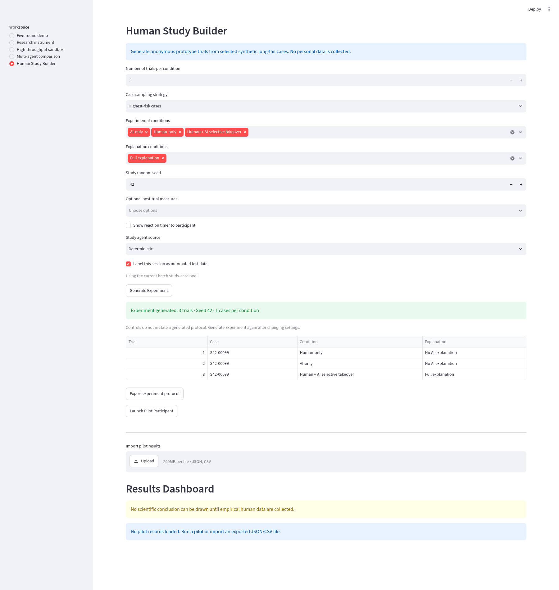

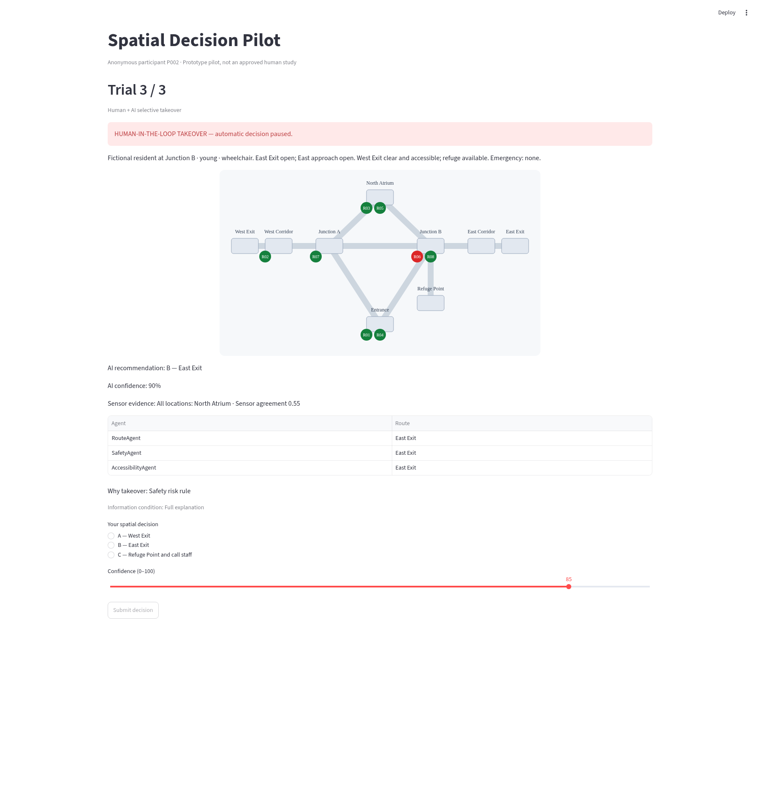

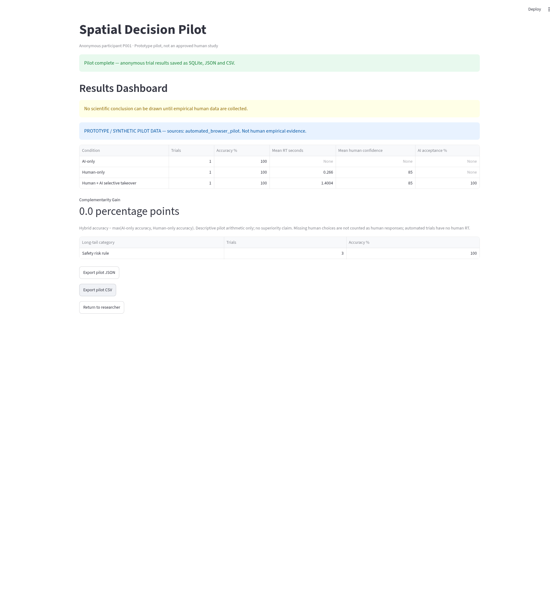

## Final integration and reproducibility

All six milestones use the same `triage.py` definition. Historical imports and
screenshots 01–14 are retained. Core/default thresholds remain uncalibrated.
The current implementation intentionally keeps the old root imports rather than
moving the validated CLI modules behind new package paths.

```text
app.py                         workspace selection and shared map
triage.py                      single scientific score/rule implementation
demo.py                        validated standard-library CLI
web_simulation.py              legacy five-round state
research_config.py / research_ui.py
synthetic_cases.py             original six-factor benchmark
batch_simulation.py / batch_ui.py
agents/                        Concordia adapter and inspected API notes
agents_ui.py                   structured comparison
experiment/                    builder, participant state, storage, analysis
study_ui.py                    researcher/participant screens
test_web.py / tests/            Python regression/instrument tests
test_browser.cjs                Milestone 2/3 real-browser workflow
test_platform_browser.cjs       Milestone 4/5/6 real-browser workflow
screenshots/                   all fourteen documented states
data/                          ignored local anonymous pilot logs
```

Final checks: **26 test methods passed**, with no failed/skipped tests;
both Chromium scripts passed their complete workflows, without browser runtime
errors. Standard-library CLI validation runs in a temporary directory so it does
not overwrite the retained baseline report. Package dependency integrity was
checked with `python -m pip check`. Pilot persistence and JSON/CSV round trips
were checked against the exported records, not only an HTTP health response.

```bash
python -m unittest discover -v
node test_browser.cjs
node test_platform_browser.cjs
```

Browser scripts require Playwright + Chromium, already installed in the cloud
runtime; they are development checks rather than application dependencies.
They generate screenshots and explicitly marked automated pilot logs. The app
runs locally; the repository screenshots can be viewed directly on GitHub.
Live processes and browser sessions are not assumed to survive a new environment.

Technical limits: local SQLite/files and Streamlit session state are not a
production multi-user/authentication system. Protocol import/resume, calibrated
client-onset RT, durable deployed storage and formal counterbalancing are not yet
implemented. Concordia integration is a bounded, single-turn entity adapter,
not a full memory/world engine. Real provider behavior, cost and availability
remain untested. JSON/CSV pilot mirrors rely on writable local storage.

Scientific limits: independent uniform factor sampling is a stress-test space,
not a calibrated population model. Scores, context mappings, route references,
difficulty rankings and study conditions need external validation. Descriptive
associations and aggregate complementarity arithmetic cannot establish causal
effects, human effect sizes or Hybrid superiority. Repeated case presentations
may introduce learning/carryover. No real human behavioral data were collected.

**Recommended Milestone 7:** preregister a small, institutionally approved human
pilot; refine task validity and accessible stimuli; implement counterbalancing,
client-timestamp validation and deployment/privacy controls; then evaluate
behavioral validity, decision quality, cognition, workload, trust calibration and
complementarity before calibrating thresholds or scaling generative simulation.

**Collaborator description:** New Research Paradigm explores a large synthetic
spatial-decision space, deterministically triages ordinary and long-tail cases,
exposes structured agent disagreements, and turns selected tails into anonymous
human-in-the-loop pilot trials—while keeping simulation evidence separate from
future human empirical evidence.

## Public Showcase

Start the **60-second Demo** to watch eight green virtual occupants move.
R06 gradually loses confidence and turns amber while automation continues.
The validated blocked-exit crisis turns R06 red and freezes the sandbox.
The story timer stops for your A/B/C decision and confidence; it never times out.
Your choice resumes the story: A reaches West Exit, B remains unsafe, C waits at refuge.
A final 40/39/1 report compares the scripted AI recommendation, your judgment and hybrid outcome.

The narrative has 55 seconds of active story time plus your response time, so a
brief response produces approximately a 60-second demo. Normal operation runs
0–12s, emerging risk 12–25s, crisis 25–35s, human judgment pauses at 35s, recovery
runs 35–45s after submission, then the report is held for the final ten seconds.
The report remains available afterward. You can pause/resume, reset, or skip
straight to takeover. Skip still evaluates all five core rounds by completion;
counts are actual outputs of the preserved `Simulation` state, not invented UI
numbers. Intermediate deterioration is a narrative monitoring cue; it does not
replace the validated threshold rule or add observations to the five-round tally.

The map uses lightweight SVG interpolation and animated route traces. Occupants
and route animation stop while paused. Reduced-motion preferences disable smooth
interpolation and route animation while preserving logical stage progression.
Frozen observations stay fixed through confidence changes and long decision
waits. The crisis comes from the original R06 injection and triage implementation.

**Public-session boundary:** this workspace calls no LLM/provider, participant
store, database, export writer or authentication service. Viewer choices exist
only in that browser's Streamlit session; Reset/reload creates a clean story.
No participant IDs or durable study logs are generated. Research/pilot tools are
separate, explicitly selected prototype workflows; do not use this public
showcase as a formal participant-study collection endpoint. Static filesystem
serving and framework usage telemetry are disabled. Credentials are never shown.

**97.5% is a scripted prototype result, not a real-world automation estimate.**
**Human-alone and Hybrid performance require empirical validation.** B/C are not
forced into a safe ending: B displays an unsafe blocked approach; C displays
pending staff assistance and unconfirmed evacuation.

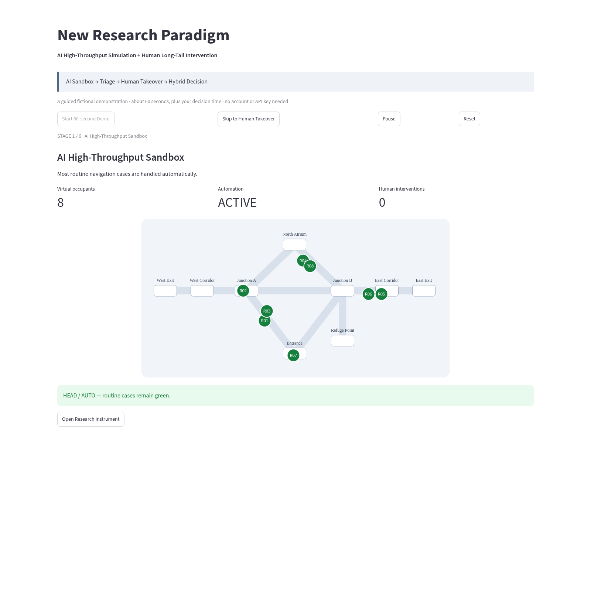

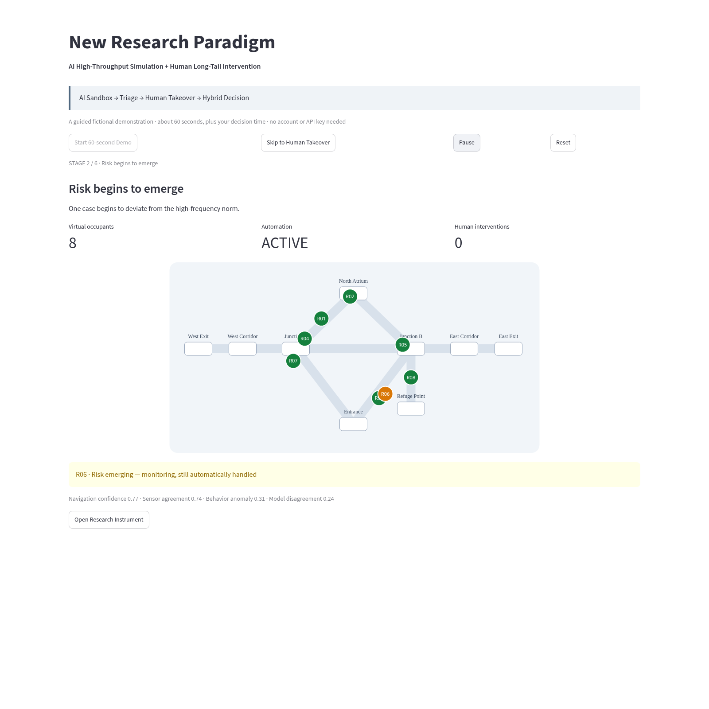

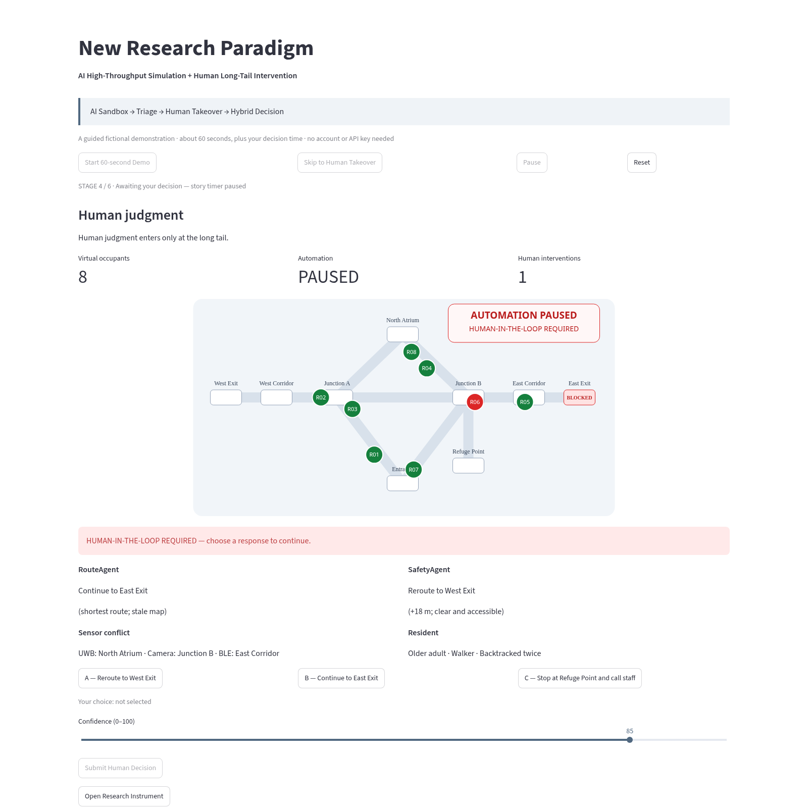

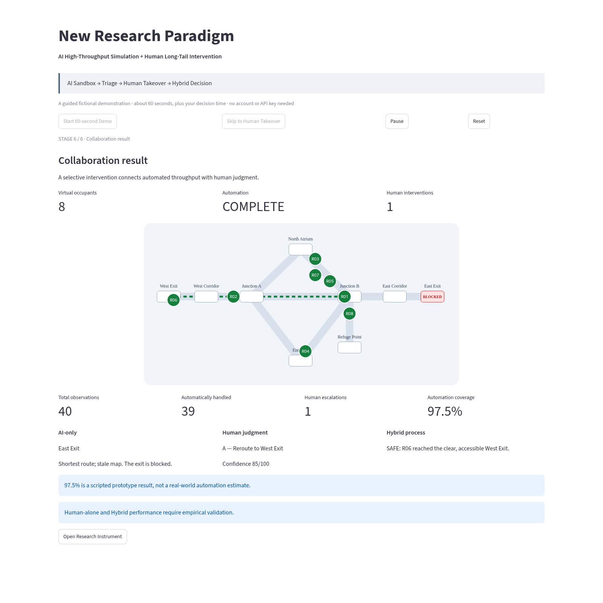

[Watch/download the approximately 61-second browser recording](artifacts/showcase-demo.webm).
This records the real wall-clock A/85 browser workflow using browser frames and
FFmpeg. It is a fictional demonstration, not a human-participant recording.
Native Playwright video was unavailable; the tested FFmpeg fallback was used.

### Streamlit Community Cloud deployment

The deployment entry point is **app.py** on **main** in
**zhoujia07-hash/NewResearchParadigm**. Choose **Python 3.12**. Community Cloud
installs `requirements.txt`; `requirements-agents.txt` remains optional and is
not needed for the public showcase. No API keys, private secrets, Redis, Docker,
Concordia installation or real LLM calls are required. Default landing and engine
are Showcase / deterministic. The cloud manages the server port/address; the
repository configuration does not pin a loopback host or a fixed port.

**Single manual deployment action:** log in to
[Streamlit Community Cloud](https://share.streamlit.io), create a new app, select
`zhoujia07-hash/NewResearchParadigm` → `main` → `app.py`, choose Python 3.12 in
advanced settings, and click **Deploy**. For public visitors, keep app sharing
public when the account/repository permissions allow it. No secrets need to be
entered. After a successful deployment, use its actual generated public URL and
place it near the top of this README; do not infer or invent a subdomain.

Automatic deployment was not performed: this cloud environment's outbound proxy
returned 403 for `share.streamlit.io` and `docs.streamlit.io`, and there is no
available authenticated Community Cloud deployment session/tool. All engineering
and local verification are complete; no publicly accessible live URL has yet
been verified. The official deployment guide is
[Deploy your app](https://docs.streamlit.io/deploy/streamlit-community-cloud/deploy-your-app).

### Showcase verification

```bash
python -m unittest discover -v
node test_showcase_browser.cjs
UPDATE_SCREENSHOTS=0 node test_browser.cjs
UPDATE_SCREENSHOTS=0 node test_platform_browser.cjs
```

The full Python suite contains 32 methods, including clean start, elapsed-time
transitions, manual pause/resume, indefinite takeover, exact R06 crisis, A/B/C
outcomes/counts, reset, research navigation, reduced motion and no participant
persistence/provider calls. Existing Milestones 1–6 remain included. The public
browser script uses real elapsed time, not an accelerated clock: it observes
normal movement, gradual risk, blocked exit, frozen actors, A/85 recovery, West
Exit, final report, restart and B/C consequences. It checks reduced-motion behavior
and captures screenshots 15–18 plus the optional recording. Legacy browser checks
can disable screenshot rewriting to preserve all historical images 01–14.

The showcase adds `showcase.py` (session-only story state) and `showcase_ui.py`
(visitor presentation). It reuses the validated round engine and single triage
source without modifying their scientific definitions. No Milestone 7 empirical
study, recruitment or data collection was started.

## Standalone Vercel Showcase

The public client frontend lives in [showcase-web/](showcase-web/README.md): Next.js,
TypeScript and App Router. It introduces the environment and legend, animates the
same eight occupants, shows R06 turning amber then red, freezes at the blocked
exit, waits indefinitely for A/B/C plus confidence, and resumes to the selected
outcome and 40/39/1 report. Hover, click, tap or keyboard-focus a marker to inspect
its resident profile. Reduced motion, pause/resume, skip and clean reset are included.
It uses session memory only, with no API, authentication, database, LLM or participant
persistence. The original Python scientific files and Streamlit workflows are unchanged.

**Vercel settings:** repository `zhoujia07-hash/NewResearchParadigm`, branch `main`,
Root Directory **showcase-web**, Framework **Next.js**, Node **24.x**. Keep the
default install/build commands and output directory. **No environment variables.**
For a new deployment, import the repository in Vercel and click Deploy; allow public
access in Deployment Protection settings if enabled by your account. The project
owner has confirmed V1 is successfully deployed; no URL is inferred here.
See the [frontend deployment and test instructions](showcase-web/README.md).

Production build and five frontend model/parity tests passed. The existing Python
suite still passes all 32 methods. Real Chromium verification covers A/85 through
West Exit, gradual amber/red transitions, blocked exit and pause, reset, B/C,
390px mobile layout, reduced motion, and no browser errors or external requests.
97.5% remains a scripted prototype result, not a real-world automation estimate;
Human-alone and Hybrid performance require empirical validation. No Milestone 7
study or empirical work was begun.

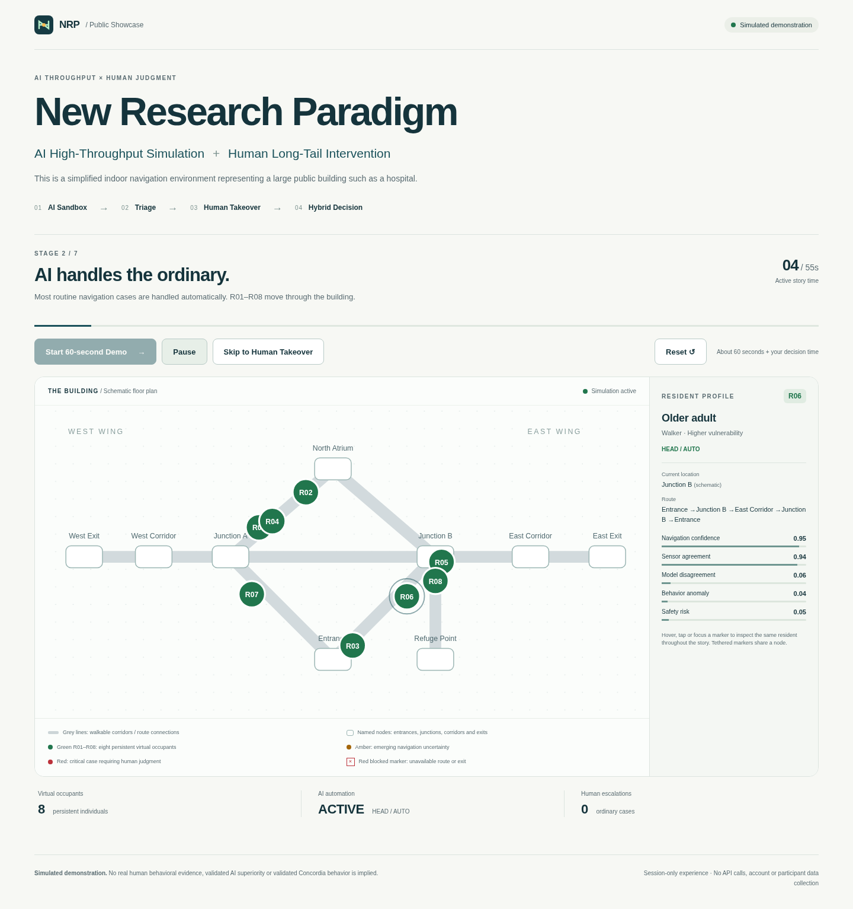

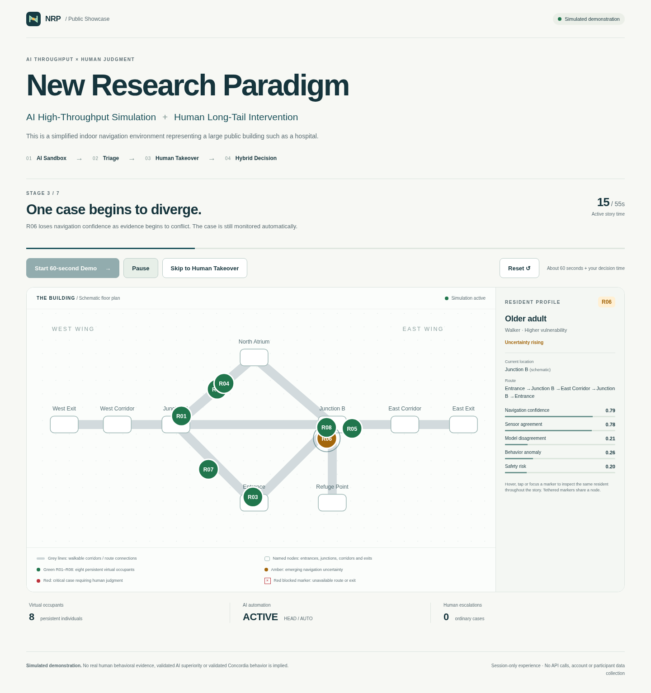

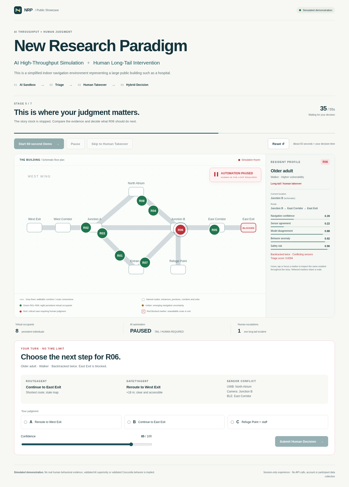

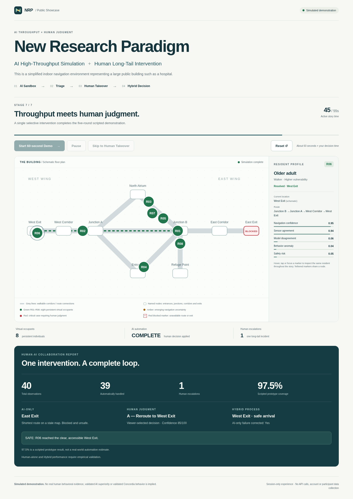

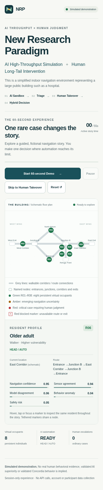

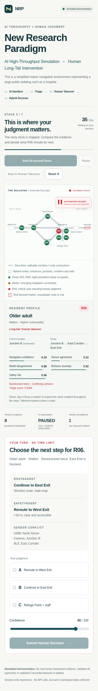

## V2.1 — 3D Spatial World

V2.1 is an intermediate development stage on `main`: browser-native **Three.js +
React Three Fiber** in the existing Next.js / TypeScript / App Router frontend.
The default 3D view reconstructs all nine V1 places and ten connections as a
procedural hospital-like cutaway: floors, corridor walls and openings, rooms,
furnishings, doors, reception, atrium landmarks, exit signage and an East Exit
barricade that appears with the existing crisis. No proprietary character,
texture, font or building assets are downloaded. All geometry and labels are
built locally in code.

The same R01–R08 identities are articulated human figures with distinct neutral
clothing, moving legs/arms, turning, stopping and small walking motion. R06 is
an older adult with grey hair and a walker. Green, amber and red rings / identity
labels indicate status; clothing and skin are not recolored as risk indicators.
R06's slowdown, two backtracks and hesitation are explicitly scripted spatial
choreography. Overview View shows the building and residents; Follow Person View
tracks the selected resident smoothly from a closer third-person camera.
Click an avatar or use the accessible identity buttons to select its profile.

**One story, two views.** The 2D View remains the extracted V1 schematic, including
its shared-location marker layout. Switching 2D / 3D never resets or advances the
story, changes a human choice or creates separate observations. Both consume the
same React story state. The original `showcase-web/lib/story.ts` is byte-identical
to V1, including timing, factors, triage formulas / thresholds, indefinite human
pause, A/B/C and 40/39/1/97.5% counting. Python scientific/platform sources are also
unchanged. A still reaches West Exit, B stops at the unsafe blocked approach, and
C reaches Refuge Point with staff assistance pending. Profiles retain their
original content; in 3D the schematic location follows the nearest node to the
scripted visual position, without altering any scientific observation.

**Presentation structure:** `app/page.tsx` composes the story and panels;
`components/scene/` contains Environment3D, BuildingModel, ResidentAvatar,
CameraController, SceneControls, the retained Schematic2D, local text labels and
the shared viewport. `components/panels/` holds the original resident, status,
story, decision and report presentation. `types/environment.ts`,
`lib/environmentModel.ts` and `lib/navigationModel.ts` define spatial coordinates
and visualization choreography. No scientific formula lives in a visual component.

The 3D chunk is loaded only on the client. Mobile uses pixel ratio 1, fewer
furnishings, no shadows and no antialiasing. Reduced motion disables gait/bobbing,
uses discrete avatar positions and a fixed wider follow camera instead of
continuous tracking. Unsupported WebGL automatically falls back to the same 2D
story. The 2D toggle remains available throughout. No backend, database, login,
API key, LLM, participant persistence or external runtime service is required.
Vercel settings remain `main` / Root Directory `showcase-web` / Next.js / Node 24.x,
default build/output, no environment variables.

> 3D avatar behavior in V2.1 is a scripted visualization of the existing prototype logic, not an empirically validated human navigation model.

There is **no individual human model**, sense-of-direction model, spatial-memory
model, stochastic navigation distribution, empirical lostness prediction or
adaptive phone/wearable intervention. Avatars are not validated substitutes for
real people. This adds no real human evidence, real LLM integration or Milestone 7.
**V2.2 and V2.3 have not been started.** All V1 caveats remain: 97.5% is a scripted
prototype result, not a real-world automation estimate; Human-alone and Hybrid
performance require empirical validation.

Validation: `npm install`, `npm run typecheck`, **10 frontend tests**, production
`npm run build`, **32 Python regression tests**, real-time Chromium 3D and retained
2D browser flows. The 3D browser test checks actual WebGL pixels and actual avatar
groups, raycast selection, cameras, green/amber/red, two backtracks/hesitation,
barrier, frozen positions, shared-state toggles, A/85 safe arrival, B/C outcomes,
reset, reduced motion, 390px layout, forced no-WebGL fallback, no browser errors,
no browser storage and no external requests. Spatial tests enforce byte-level V1
story parity and prevent presentation calls from mutating story state.

```bash
cd showcase-web
npm install
npm run typecheck
npm run test
npm run build
# Start the production server in another terminal with npm start, then:
npm run test:browser:3d
UPDATE_SCREENSHOTS=0 npm run test:browser
# From repository root, using the existing Python environment:
python -m unittest discover -v
```

The browser test uses installed Chromium (`CHROMIUM_PATH` override). Headless
cloud verification uses Chromium's software WebGL renderer; real-device GPU
performance has not been benchmarked. No live V2.1 deployment URL has been
independently verified here. `showcase-v1` and the existing V1 tag remain frozen;
this is an intermediate main commit, not a new `showcase-v2` checkpoint.

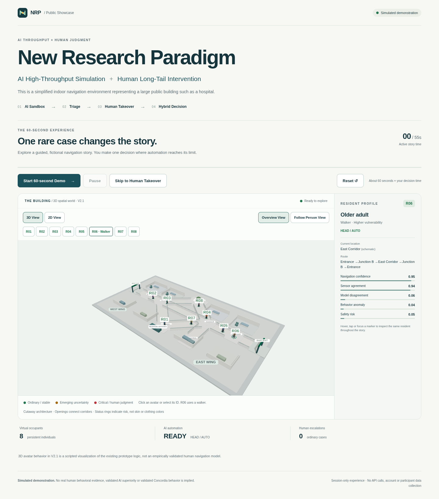


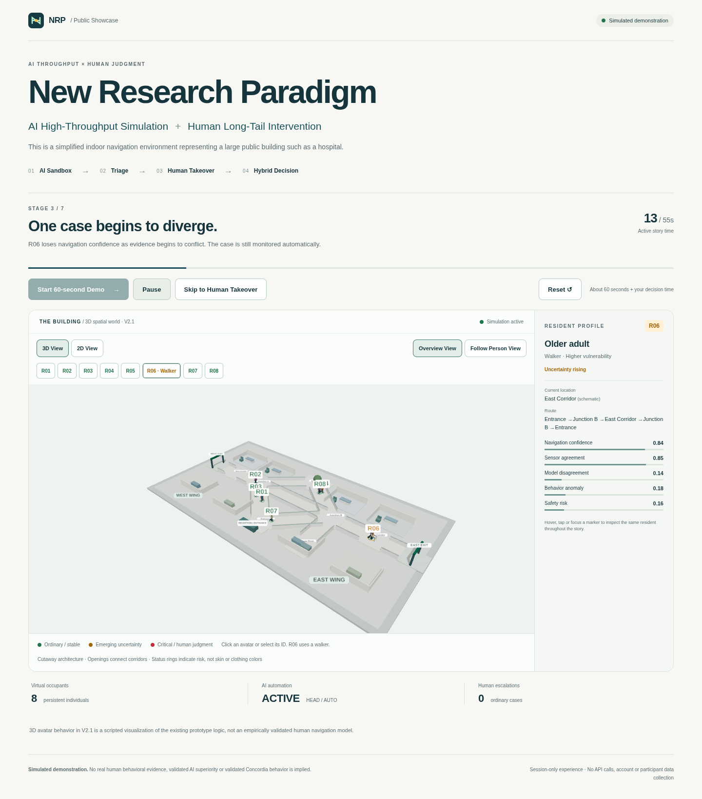

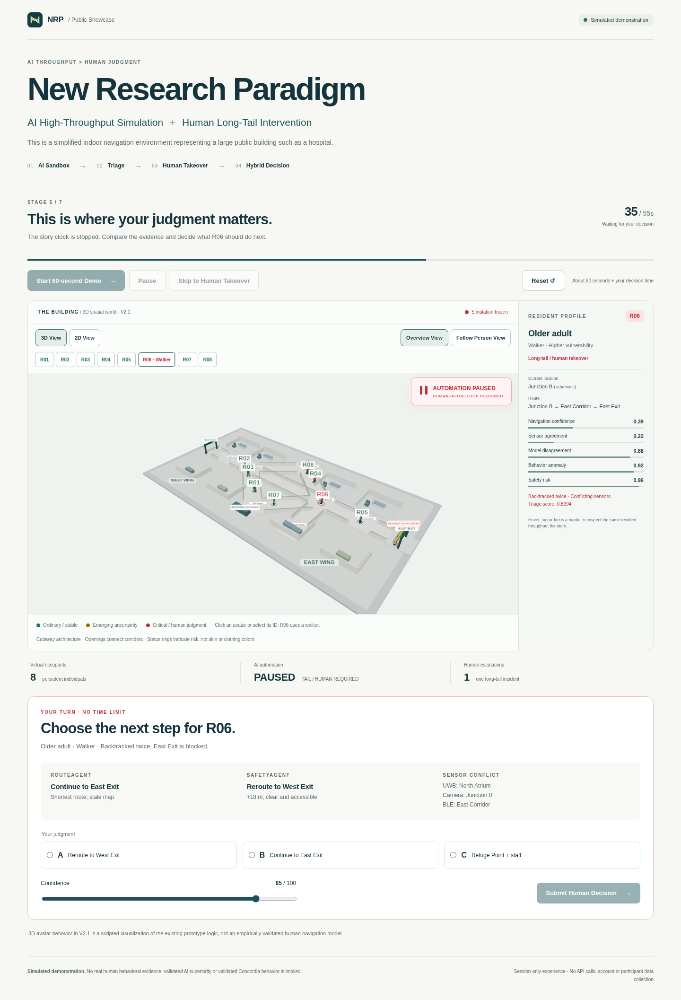

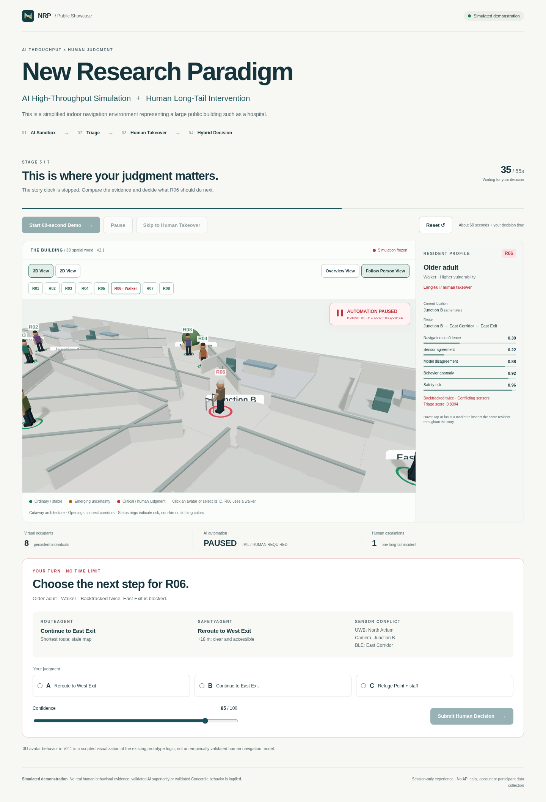

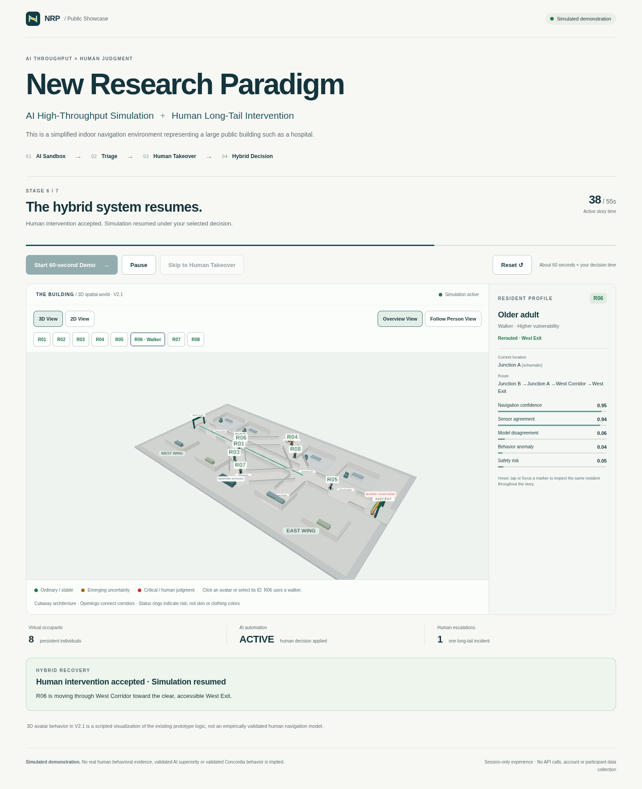

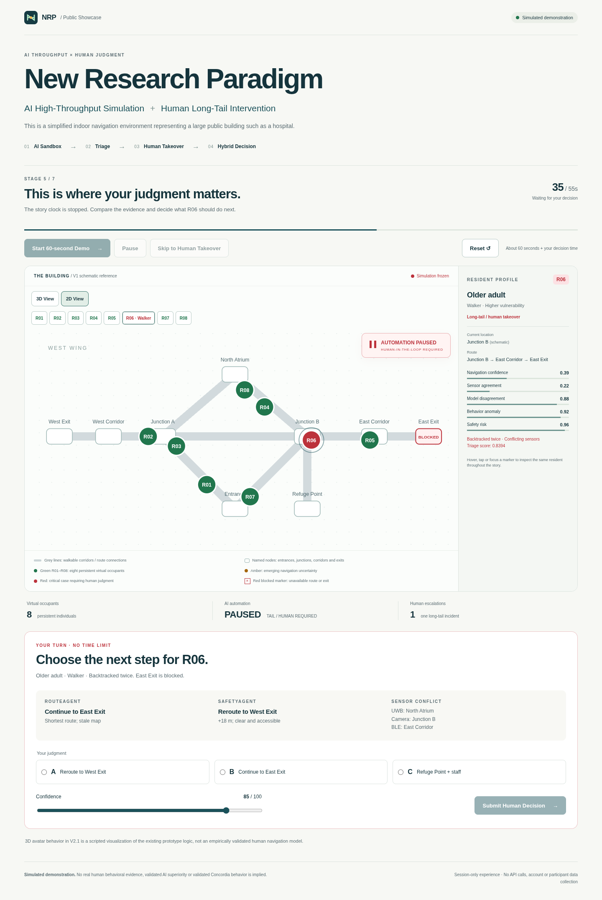

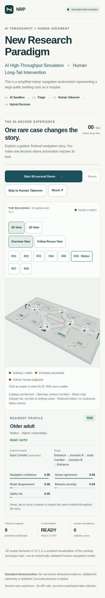

## V2.1-A — Standalone 3D Visual Prototype

A separate [design and handoff package](prototypes/v2.1-a/README.md) explores a more
polished hospital cutaway, articulated residents, R06's walker / hesitation /
backtracking, dynamic East Exit blockage and overview / follow cameras. It includes
three material variants, a scrubbable visual storyboard and six captured renders.
The prebuilt static viewer is at `/visual-prototype/index.html` after deployment;
its source and visual clock are independent of the existing scientific application.
No research logic, backend, empirical human model or intervention policy is added.

[Download the self-contained prototype ZIP](showcase-web/public/visual-prototype/v2.1-a-package.zip).
Extract and serve its `browser/` directory with any static host; source, build files,
asset manifest, design rationale, storyboard, palettes and third-party notices are
included. No API key, login, database or external runtime asset is required.
The existing application and all frozen V1 references remain unchanged.

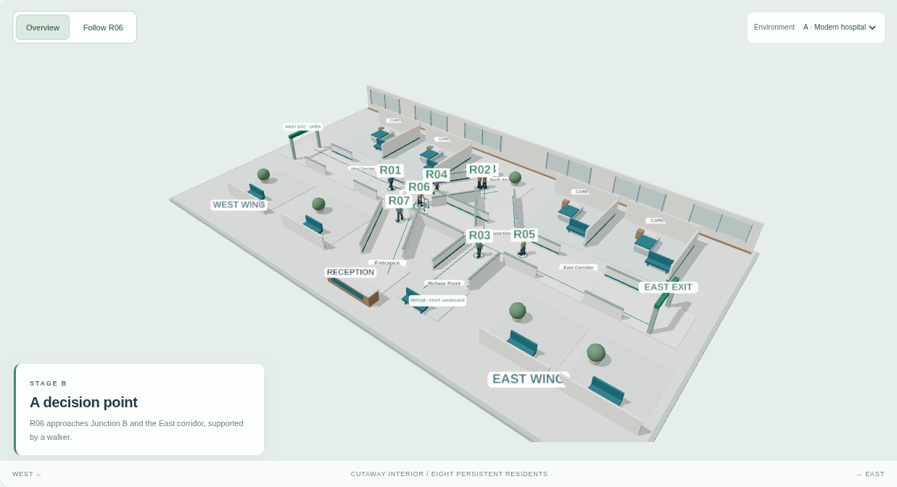

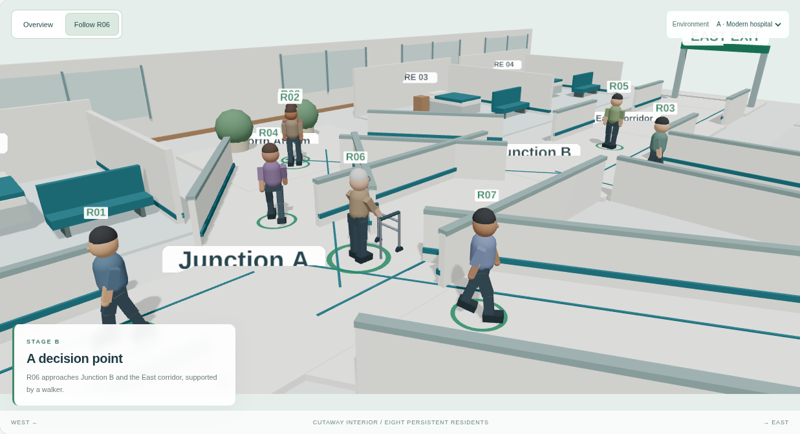

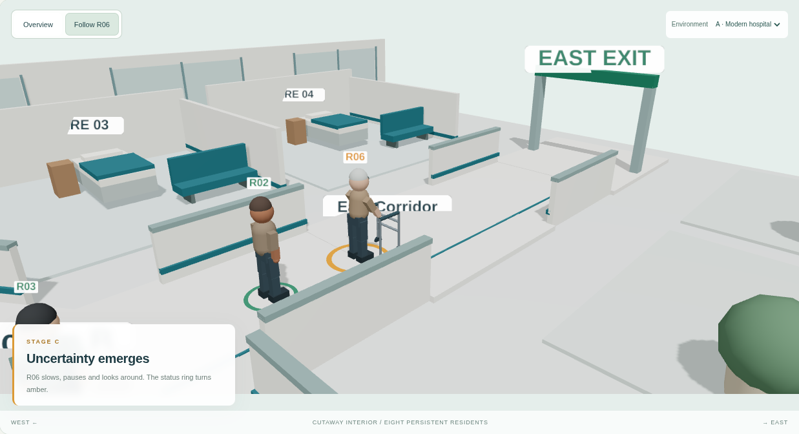

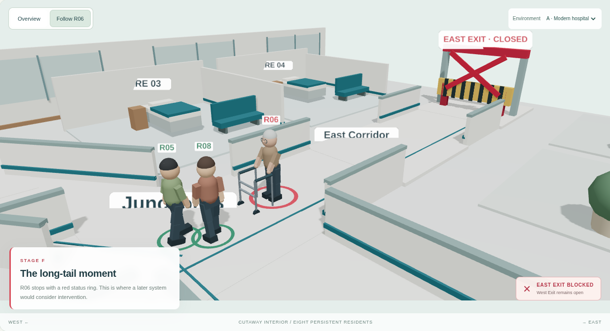

**Visual prototype only — scientific logic integration will be completed later.**

## V2.1-B — integrated Modern Hospital (review branch)

The approved V2.1-A Modern Hospital and articulated avatars are integrated into
the existing Showcase on `v2.1-b-integration`, based exactly on
`e9a72b9a87b91b010911dafe2117bcac908a0457`. This is awaiting human visual review;
main, production and the permanent V1 checkpoint are not promoted or changed.

[Integration architecture, validation and all nine screenshots](V2_1_B_INTEGRATION.md)

`showcase-web/lib/story.ts` remains the unchanged scientific source of truth.
The standalone prototype's 48-second visual clock does not drive this app.
Default 3D, retained shared-state 2D, Overview / Follow R06, mesh/ID selection,
and the original A/B/C takeover and outcomes are available. No new dependencies,
trait models or inference runtime are introduced.

3D avatar behavior is a scripted visualization of the prototype state machine
and is not an empirically validated model of human navigation.
97.5% is a scripted prototype result, not a real-world automation estimate.

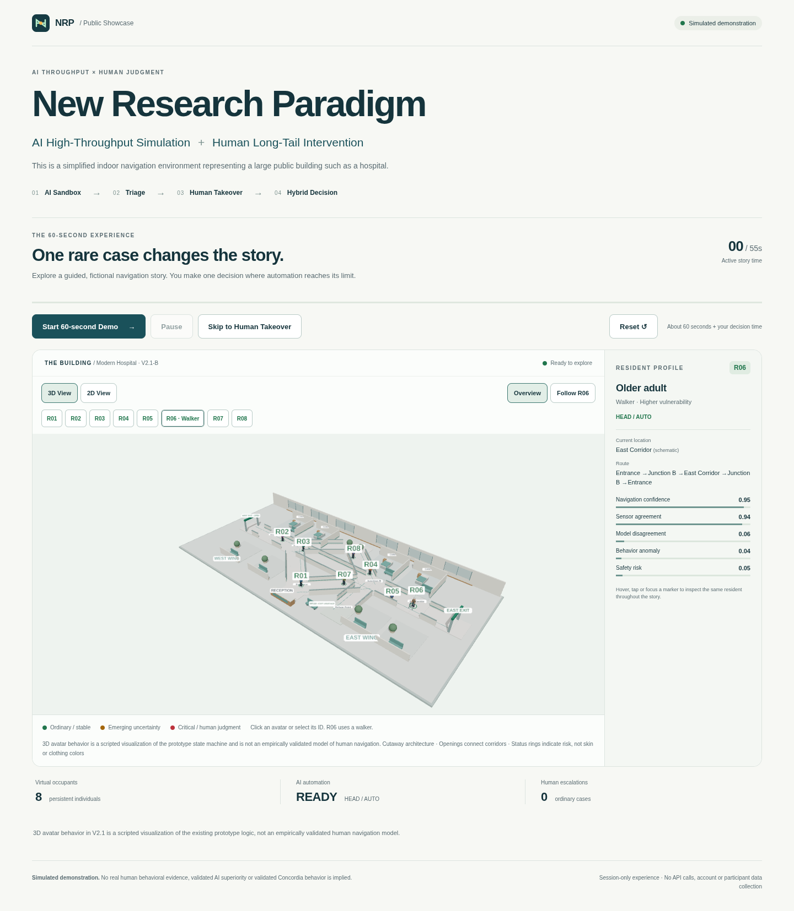

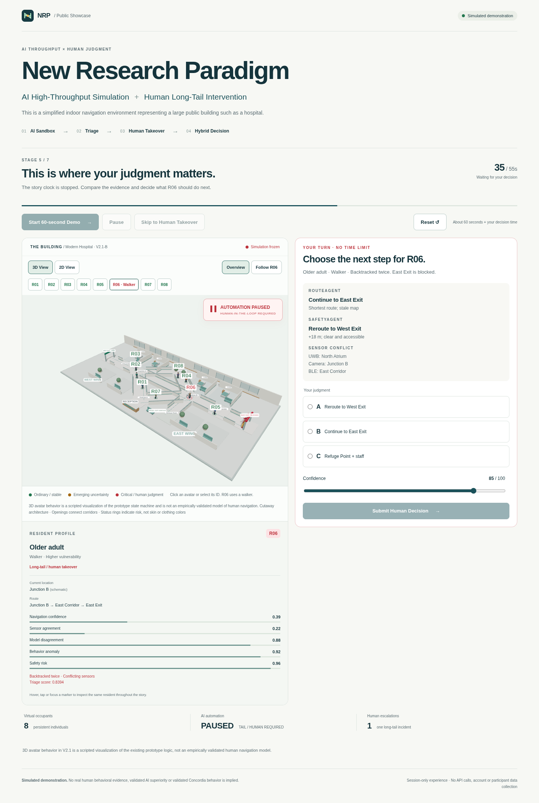

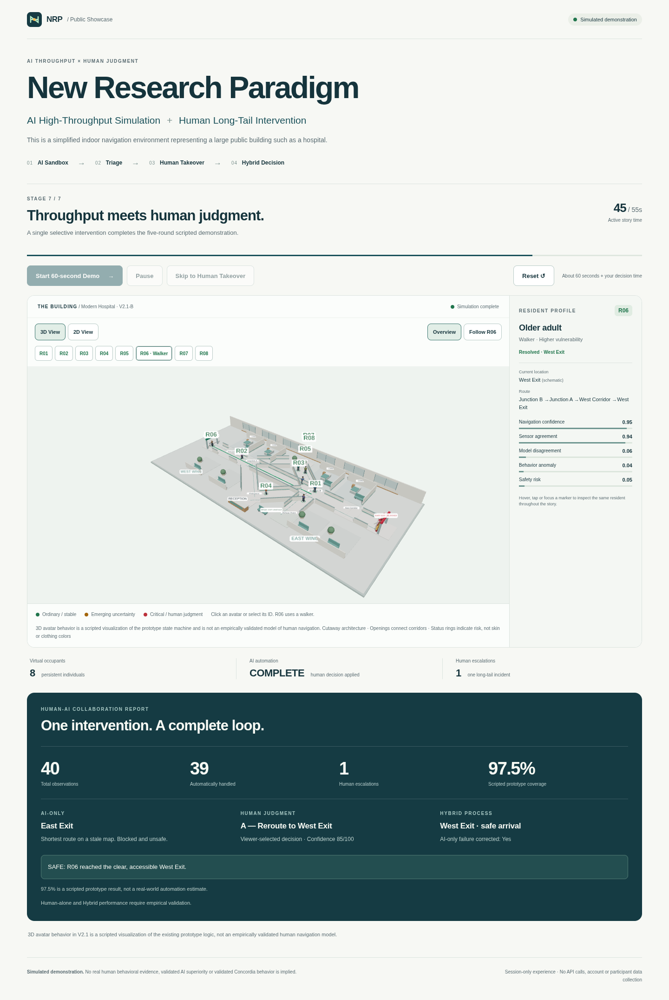

## V2.2-A — Human–Machine–Environment architecture (review branch)

[HME_ARCHITECTURE.md](HME_ARCHITECTURE.md) documents the separate Human,
Environment, Machine/IT and Mobility types, coupling/model-replacement contracts,
versioned ModelRegistry, legacy Story compatibility, and three future research
configurations. The existing Showcase still runs the unchanged Story engine.
Unknown human states remain unknown; no empirical or adaptive model is added.

The Human–Machine–Environment architecture defines modular interfaces for
integrating future empirical models. The architecture itself does not establish
the validity of any specific human, environmental, or intervention model.

This work is on `v2.2-a-hme-architecture` for human review, without promotion to
main, production or a V2 stable checkpoint.

### Nature-informed V2.2-A refinement

The same review branch now includes a multi-scale scientific ontology, separate
conceptual and software figures, explicit strategies/history/interaction
contracts, and static evidence provenance. See [HME architecture](HME_ARCHITECTURE.md),
[Nature/NHB evidence audit](NATURE_NAVIGATION_EVIDENCE.md), and the
[complete factor index](docs/navigation-factor-index.md).
The eight citations/scopes were supplied by the project owner; publisher/DOI/
Crossref access was blocked here, so independent content verification remains
pending. Source-linked concepts are not validated models or predictors. This
framework does not control the existing Showcase, and no empirical or adaptive
model is added.

## V2.2-B synthetic Human model review

On the `v2.2-b-human-models` review branch, deterministic synthetic profiles add
person-specific meso → macro expressions in the unchanged Modern Hospital.
These are illustrative, replaceable parameters, not participant measurements or
validated effect estimates. The official R06 story and Machine decisions remain
scripted and unchanged.

See [V2.2-B Human models, exact mappings and review screenshots](V2_2_B_HUMAN_MODELS.md).
This stage awaits human scientific and visual review and is not merged to main.

## V2.2-C controlled Environment comparison (review branch)

Open `/environment-comparison` from the “Compare Simple vs Complex environments”
link on the Showcase. The separate research demo runs two synthetic hospital route
networks together, with the same selected Human, task, baseline support and clock.
Raw structural variables and illustrative H×E expressions are shown separately.

See [controlled Simple-vs-Complex comparison, exact networks and screenshots](V2_2_C_ENVIRONMENT_MODELS.md).
The original R06 story remains separate. Results are synthetic demonstrations,
not empirical evidence; this branch awaits scientific and visual review.
