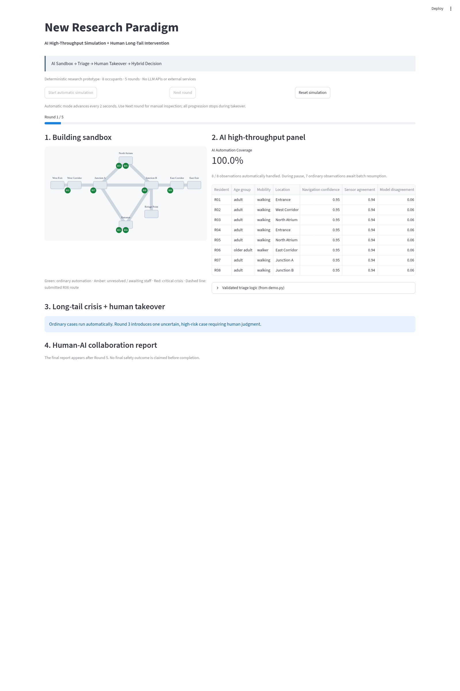
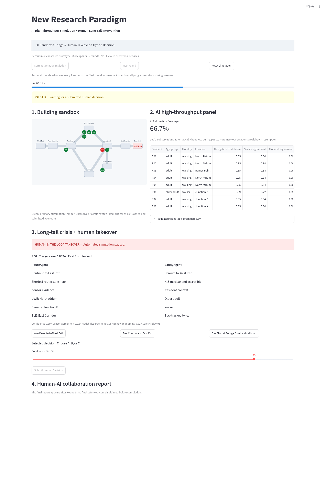
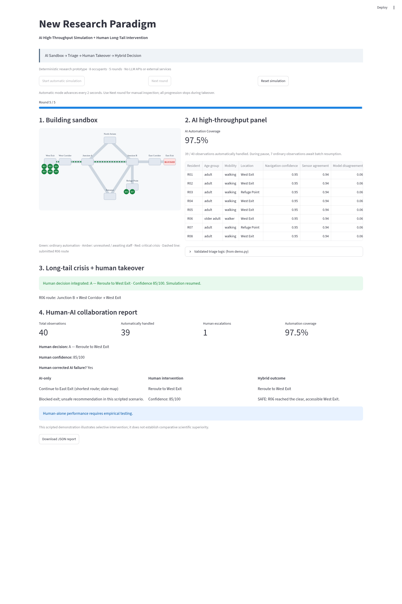
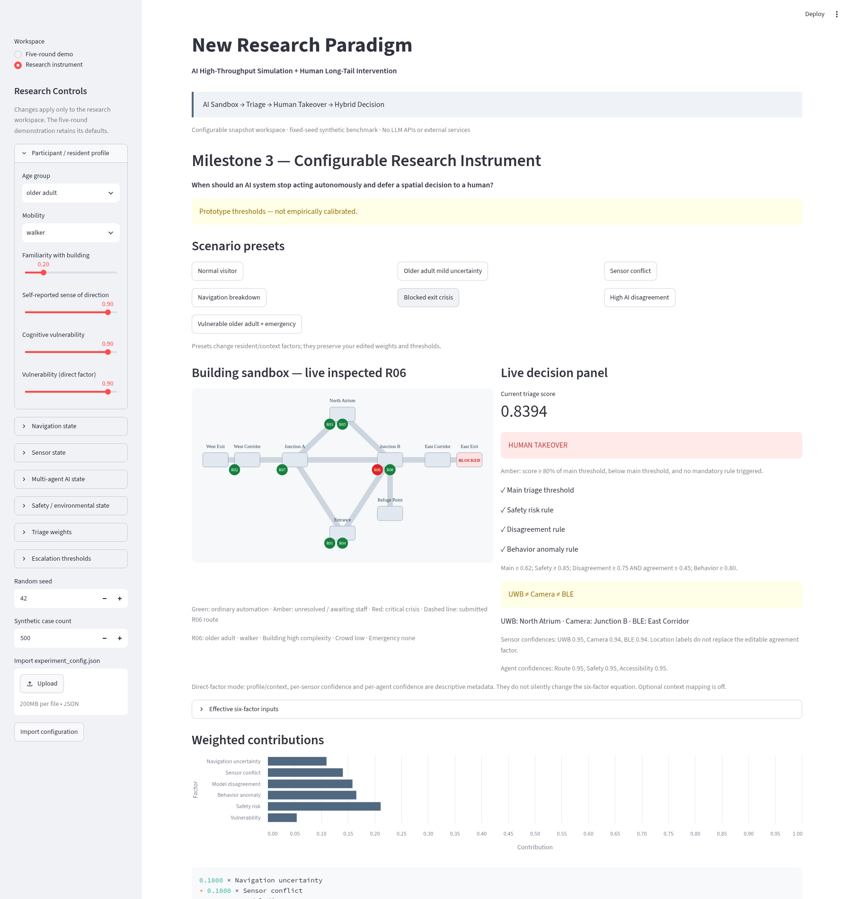
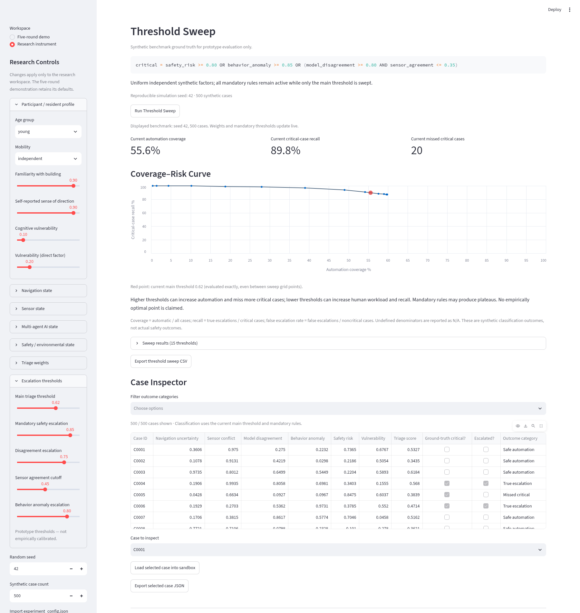
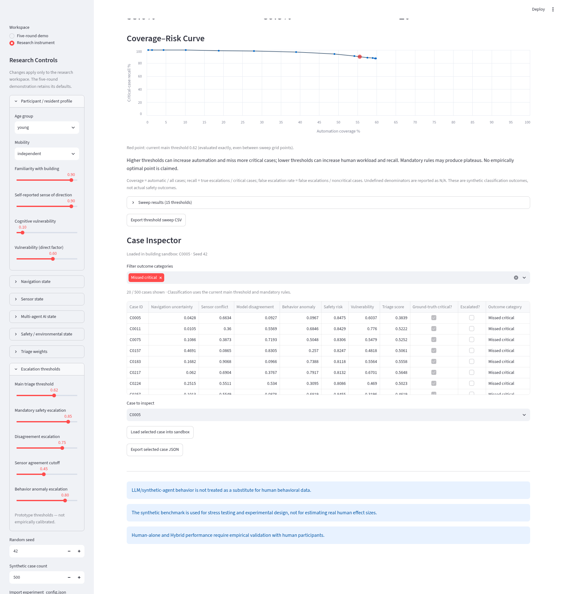

# New Research Paradigm

A deterministic research demo of AI throughput with selective human takeover.
The validated command-line baseline is `demo.py`; its scenario and decision
application are reused by the Web Demo. Milestone 3 extracts its unchanged
default scoring and thresholds into the shared `triage.py` module.
No LLM APIs, API keys, Concordia, Redis or Docker are needed.

## Run the Web Demo

From this repository, create an environment and install the single direct dependency:

```bash
python3 -m venv .venv
source .venv/bin/activate
python -m pip install -r requirements.txt
streamlit run app.py
```

In the prepared cloud machine the environment already exists:

```bash
cd /workspace/NewResearchParadigm
source /workspace/.venvs/newresearch/bin/activate
streamlit run app.py
```

Use Streamlit's reported local address in a browser on the same machine.
The cloud chat does not provide a public preview or localhost forwarding.

1. Click **Start automatic simulation** (2-second rounds), or use **Next round**.
2. Observe eight green markers moving on the schematic and the live triage table.
3. Round 3 marks East Exit blocked and R06 red. All advancement pauses.
4. Select A, B or C, set confidence, then click **Submit Human Decision**.
5. Rounds 4–5 resume. A moves R06 through West Corridor to West Exit.
6. Read the final comparison and download `hybrid_web_report.json`.
7. **Reset simulation** begins a new independent session.

A yields safe evacuation; B retains the blocked-exit hazard; C waits at refuge
with staff assistance requested and evacuation unconfirmed. These are scripted
outcomes, not empirical evidence of comparative performance. Human-alone
performance requires empirical testing.

The seven normal round-3 observations wait behind the pause barrier. After
submission they are counted as automatically processed. The final counts match
the CLI: 40 observations, 39 automatic, one escalation, 97.5% coverage.
Follow-up observations under B/C use the previously submitted human instruction
rather than opening a duplicate escalation for the same incident, as in the CLI.

## Validation

```bash
python -m unittest -v test_web.py
```

Streamlit AppTest checks real widgets, A/B/C outcomes, pause guards, automatic
progression render ticks, confidence, reset and final reports. The state engine
uses asyncio to collect eight concurrent observations per round. The SVG building
and ordinary movement paths are illustrative, not a physical evacuation model.
The Web Demo is session-local; reloads can reset it, and reports are retained only
when downloaded. It does not overwrite the CLI's `hybrid_demo_report.json`.

## Command-line baseline

```bash
python3 demo.py
```

This baseline continues to require only the Python standard library.

## Visual Demo Screenshots







## Milestone 3 — Configurable Research Instrument

The research question is: **When should an AI system stop acting autonomously
and defer a spatial decision to a human?** This milestone adds a separate
**Research instrument** workspace in the sidebar. **Five-round demo** still runs
the existing 8-person scenario, pauses in round 3, and completes A/B/C decisions.
The earlier screenshots above document that baseline; they are preserved.

### Research controls and live triage

Use the sidebar to edit resident age/mobility, familiarity, sense of direction,
cognitive vulnerability, navigation confidence, backtracking, hesitation, route
progress, sensor confidence/agreement, agent confidence/disagreement, risk,
complexity, crowd density, blocked exits and emergency context. Seven preset
buttons provide starting points. **Blocked exit crisis** imports the six factor
values from the original R06 scenario and scores **0.8394** with default weights.

The six operative factors are navigation uncertainty (`1 - confidence`), sensor
conflict (`1 - agreement`), model disagreement, behavior anomaly, safety risk and
vulnerability. The default weights remain **0.18, 0.18, 0.18, 0.18, 0.22, 0.06**.
All effective weights are normalized to sum to 1. **Normalize weights** writes
these values back to the sliders; all-zero weights are rejected. The live
contribution chart, table and equation show exactly how the score is calculated.

The main threshold defaults to **0.62**. Mandatory escalation still occurs for
risk ≥ **0.85**, disagreement ≥ **0.75** together with agreement ≤ **0.45**, or
behavior anomaly ≥ **0.80**. All five cutoffs are editable. Each rule is shown
individually, so raising the main threshold does not hide mandatory escalation.
Green means AI AUTO, amber means score ≥ 80% of the main threshold with no
escalation, and red means HUMAN TAKEOVER. Research mode evaluates a live snapshot;
it does not change the baseline round engine or automatically measure human
judgment quality.

**Prototype thresholds — not empirically calibrated.** Verification means that
the implementation matches its specification, not that these settings have
scientific validity.

### Context versus direct factors

Direct-factor mode is the default. Profile/context fields and individual
sensor/agent confidences are descriptive metadata: they do not silently alter
aggregate vulnerability, agreement or disagreement. The sensor-conflict checkbox
shows three different location reports while agreement remains independently
editable. The inspected resident is R06; the other seven markers provide context.

An optional **Enable prototype context-to-factor mapping** checkbox allows
explicit, deterministic stress-test mappings from age, mobility, familiarity,
cognitive vulnerability, hesitation, backtracking, route progress, complexity,
crowds, exit blockage and emergencies to the three effective factors of
vulnerability, behavior anomaly and risk. The exact max/floor formulas are shown
in the UI and `research_config.py`. These mappings are **uncalibrated assumptions**,
not demographic findings. They are off for all presets and when loading a
synthetic case, preserving the case's six factors exactly.

### Threshold sweep and case inspector

Click **Run Threshold Sweep** to generate **500 cases** by default (adjustable
from 200–2000) using local `random.Random(seed)`, default seed **42**. Each case
has six independent uniform [0,1] factor values. The main threshold is evaluated
at **15 points**, from 0.20 through 0.90 in steps of 0.05. The current effective
weights and all mandatory rules apply at every point.

The synthetic benchmark critical label is deliberately transparent:

```text
critical = safety_risk >= 0.80
        OR behavior_anomaly >= 0.85
        OR (model_disagreement >= 0.80 AND sensor_agreement <= 0.35)
```

**Synthetic benchmark ground truth for prototype evaluation only.** It is a
constructed label, not observed human safety data. It is independent of the
researcher's edited escalation settings. Metrics are:

- Automation coverage: automatically handled cases / all cases.
- Human escalation rate: escalated cases / all cases.
- Critical-case recall: escalated critical cases / critical cases.
- Missed critical cases: critical cases handled automatically.
- False escalation rate: escalated noncritical cases / noncritical cases.

Undefined recall or false-escalation denominators are reported as N/A. The
coverage–risk curve plots coverage against recall, with the current threshold
marked in red. The exact current threshold is evaluated even if it falls between
grid points. Mandatory rules can create plateaus. Increasing automation can miss
critical cases; increasing escalation can increase human workload. **No optimal
threshold or superiority claim is implied.**

Filter the **Case Inspector** by True escalation, Safe automation, Missed critical
or False escalation. Choose a case and click **Load selected case into sandbox**.
Its six inputs load into R06's controls and visualization. These outcome names
refer to synthetic classification, not observed evacuation safety outcomes.
Weights/threshold changes update the existing benchmark live; seed/sample-count
changes show a stale-benchmark warning until a new sweep is run.

### Export, import and reproducibility

Download `experiment_config.json` to save all controls, normalized weights,
thresholds, seed and sample count in a versioned schema. Import it using the
sidebar uploader and **Import configuration**. Invalid/nonfinite values, unknown
settings and unsupported schema versions are rejected without partial changes.
Import clears the old benchmark; run a new sweep.

Download `threshold_sweep.csv` for all 15 result rows, seed, weights and mandatory
cutoffs. Download `selected_case.json` for the selected case's original factors,
seed, classification and evaluation settings. Session state is local to the
browser session; these exports are the durable experimental record. There is no
participant database, persistent study log or real LLM/agent service.

Visible scientific cautions throughout the instrument include:

- LLM/synthetic-agent behavior is not treated as a substitute for human behavioral data.
- The synthetic benchmark is used for stress testing and experimental design, not for estimating real human effect sizes.
- Human-alone and Hybrid performance require empirical validation with human participants.

### Launch and validation

For a new machine, install the same single direct dependency, Streamlit:

```bash
python3 -m venv .venv
source .venv/bin/activate
python -m pip install -r requirements.txt
streamlit run app.py
```

Then select **Research instrument** in the sidebar. In the prepared cloud machine,
activate the existing virtual environment as shown in the earlier Run section.
Altair is included among Streamlit's required dependencies; no additional package,
API key, Concordia, Redis or Docker was introduced.

```bash
python -m unittest -v test_web.py
```

The 13 test methods cover the three mandatory escalation rules and boundaries,
normal/R06 scoring, normalization, seed determinism, all 15 sweep points, metric
arithmetic, coverage/recall monotonicity, configuration validation, context-mapping
isolation, inspector loading, the standard-library CLI, and the existing A/B/C
web workflows.

The shared source of truth is now `triage.py`, extracted from the CLI without
changing its default formula. `demo.py` retains the original occupants, crisis,
asyncio workflow, human input and report. `web_simulation.py` retains the round
state; `app.py` selects/render workspaces; `research_ui.py` renders research
controls; `research_config.py` handles presets/schema/mapping; `synthetic_cases.py`
generates cases and sweeps.

Real browser verification is repeatable with `node test_browser.cjs` when
Playwright and Chromium are available (already provided in this cloud runtime).
Start Streamlit first. The browser test checks normal/crisis presets, red and
amber markers, threshold changes, chart rendering, missed-critical filtering,
case loading, JSON/CSV exports, JSON import, and the baseline A/85 round workflow.
It regenerates screenshots 04–06 and stores downloaded test outputs in `/tmp`;
it leaves screenshots 01–03 untouched. Set `CHROMIUM_PATH` or `DEMO_URL` if needed.

At default research settings and seed 42, the synthetic benchmark contains 500
cases. At threshold 0.62 its coverage is **55.6%**, recall **89.8%**, and there are
**20 missed critical cases**. These figures describe this artificial distribution
only; they are not estimates of real human behavior or real-world risk.

### Research instrument screenshots







### Next research milestone

A sensible Milestone 4 is a small human-participant pilot: define task scenarios
and study conditions, add consent/session identifiers and timestamped interaction
logs, counterbalance AI-only/Human-only/Hybrid conditions, and export comparable
human outcomes. Use those data to evaluate decision quality, workload, confidence
and intervention timing before calibrating thresholds or adding real LLM agents.
