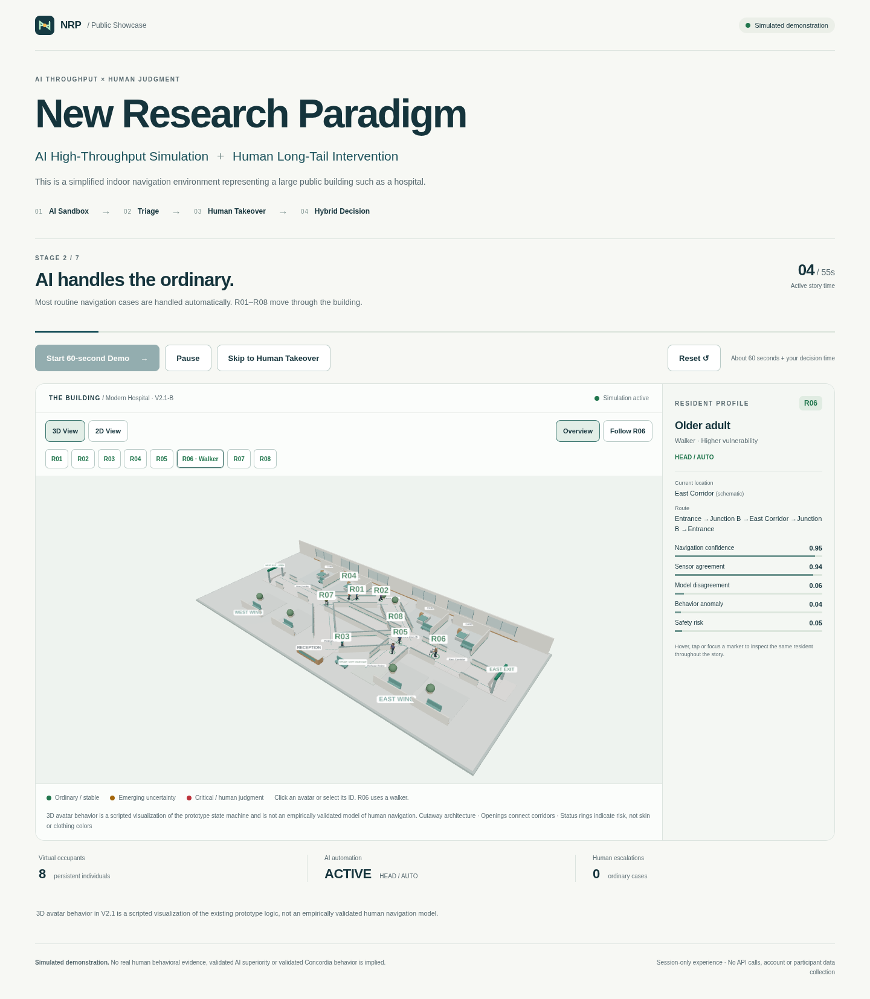
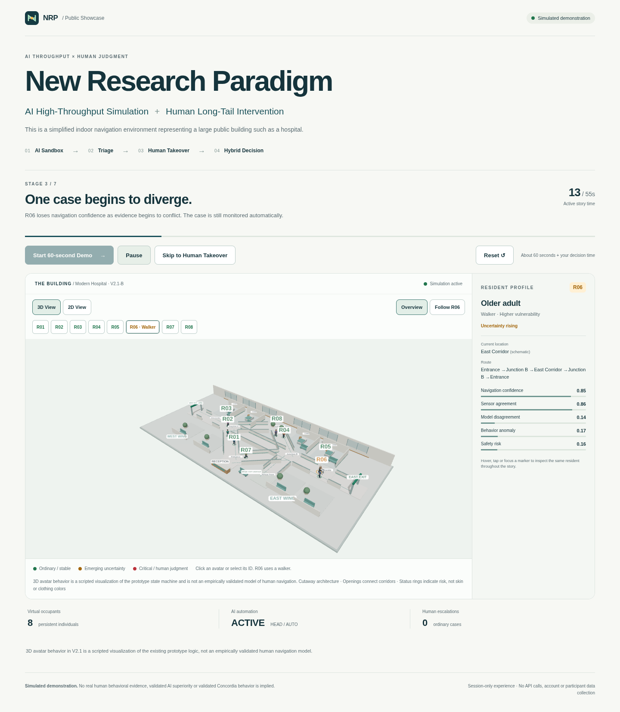
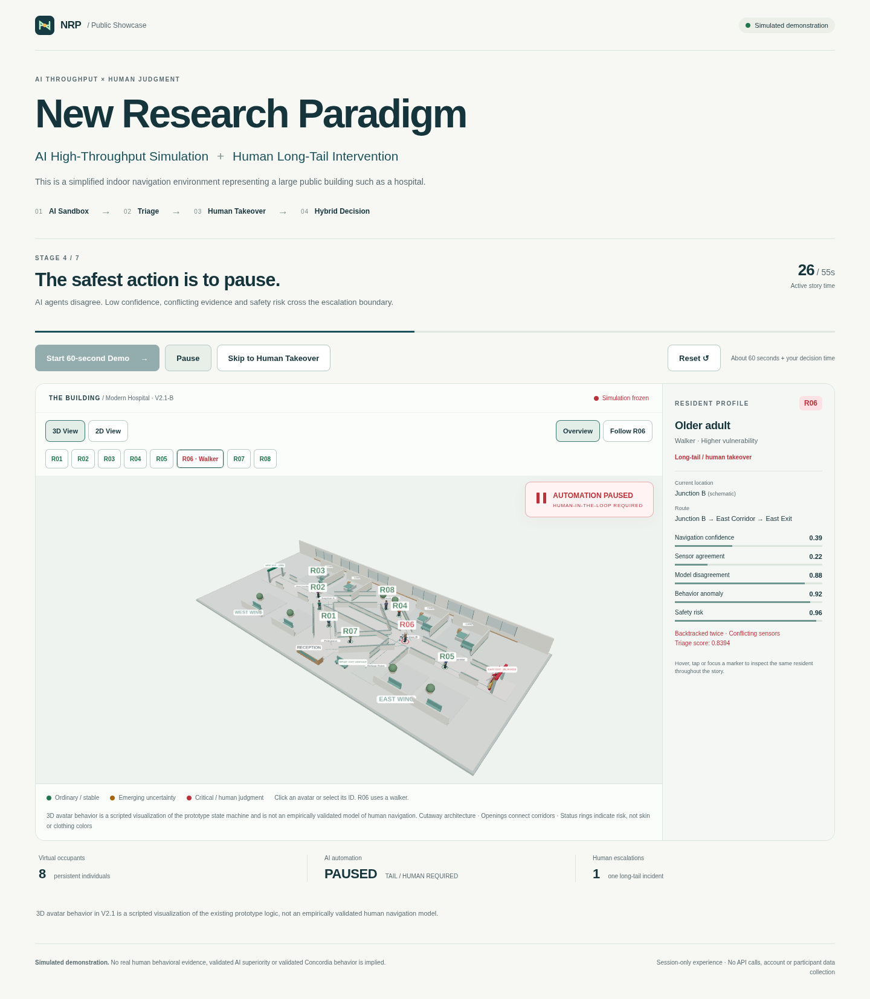
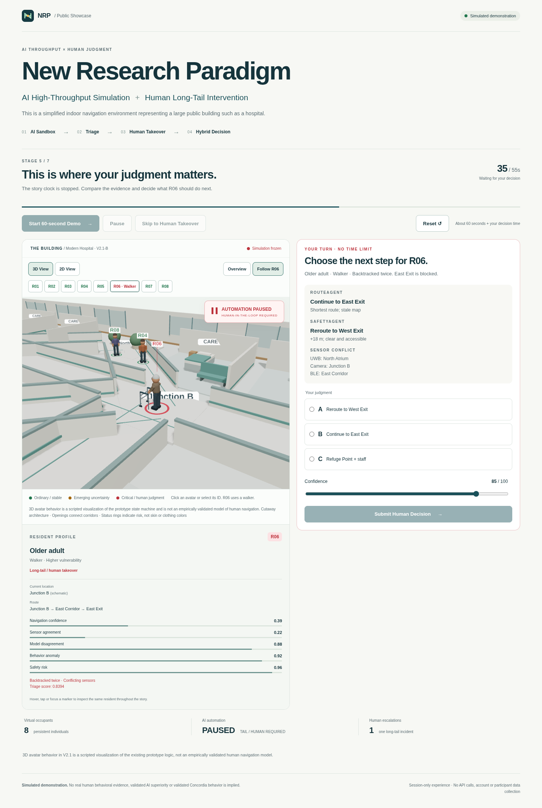
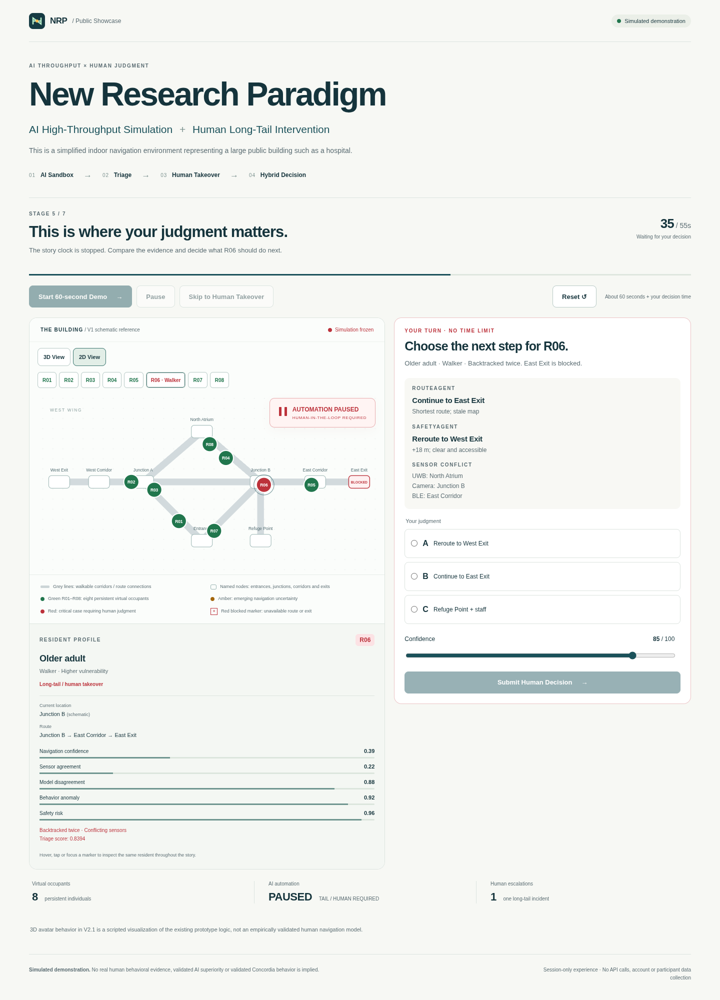
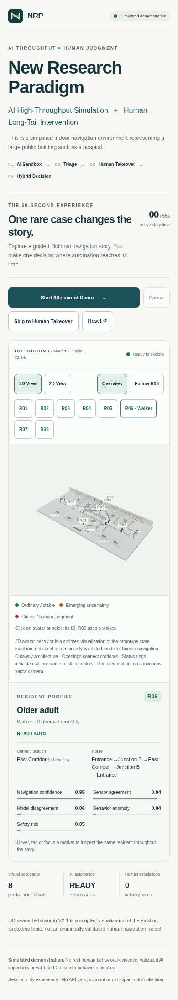

# V2.1-B — Modern Hospital integration (human review branch)

Branch: `v2.1-b-integration`. Exact base:
`e9a72b9a87b91b010911dafe2117bcac908a0457`.
This branch is not a release checkpoint and must not be merged or promoted to
production without human visual review. No V2 tag is created.

## Architecture and scientific boundary

`showcase-web/lib/story.ts` → official `Story` → `navigationModel.ts` and
`spatialPresentation.ts` → `HospitalModel`, `ResidentAvatar`, `CameraController`.
Both 3D and the retained V1 2D schematic consume the same Story instance in
`app/page.tsx`. There is one observation ledger and one human decision gate.

The approved V2.1-A Variant A geometry, articulated bodies, walker and local
canvas-generated labels are adapted into production components. They do not
import runtime code from `prototypes/v2.1-a/`. That archived package and its
48-second art storyboard are unchanged and do not control the integrated app.
The hospital's nine anchors and ten connections come from the V1 node graph;
room furnishings, cutaway walls and walking lane offsets are presentation only.

No scientific sources, factors, weights, thresholds or outcomes are changed.
`story.ts` is byte-identical to frozen V1. Python parity remains tested.
There are no new trait models, navigation distributions or model inference.
No Argon, Gemini, API, external texture/model/font, backend or persistence is used.
Existing Three.js and React Three Fiber dependencies suffice; no packages added.

## Official stages, unchanged timings

| Story stage | Presentation |
| --- | --- |
| idle / intro (0–3 s) | Ready scene; persistent R01–R08, R06 older adult with walker |
| normal (3–12 s) | Walking, green status rings and ID badges |
| emerging (12–25 s) | Amber R06, slower gait, holds, head scans and two visible backtracks |
| crisis (25–35 s) | Official crisis: red R06, East Exit barricade/red X/BLOCKED signage, frozen residents |
| human (35 s, no time limit) | Frozen scene; original evidence, A/B/C choices and confidence 0–100 |
| recovery (35–45 s after submission) | A → West Exit; B → East Corridor blocked approach; C → Refuge Point |
| result (45–55 s) | Endpoint visible; original report, counters and caveats |

The presentation adapter never advances Story or makes a decision. Art poses
use `story.elapsed`, stage, freeze state and submitted choice. Only the existing
Story tick/submit functions advance the ledger and outcome. Frame rendering and
camera switching cannot advance scientific time. Follow R06 always follows R06,
even when another resident is selected for inspection.

ID badges are spaced in screen coordinates when scripted paths meet; this changes
label height only, never the resident position or Story.
The red foot ring/badge indicates critical status; skin and clothing stay natural.
The barricade appears only when `blocked(story)` becomes true. Before the crisis,
East Exit is available. Human takeover puts the scene alongside the unchanged
judgment interface on wide desktops; narrower displays retain a stacked layout.
Reset restores initial positions, green statuses, body headings and Overview.

## Accessibility and performance

Default 3D with a visible 3D/2D toggle, Overview and Follow R06. Mesh selection
updates the existing profile, and the ID buttons provide keyboard/touch access.
Local procedural low-poly geometry; limited lighting; desktop DPR capped at 1.5;
mobile DPR 1 with shadows removed and nonessential hospital detail reduced.
Reduced motion uses discrete positions, no walking/head animation or continuous
follow interpolation. Missing WebGL automatically selects the shared-state 2D
view and explains the fallback. No external runtime requests are needed.

“3D avatar behavior is a scripted visualization of the prototype state machine
and is not an empirically validated model of human navigation.”

“97.5% is a scripted prototype result, not a real-world automation estimate.”

The original 40 observations / 39 automatic / 1 escalation / 97.5% scripted
coverage is preserved for each A/B/C branch; C remains pending assistance, not
confirmed safe evacuation.

## Validation and local review

From `showcase-web/`:

```sh
npm install
npm run typecheck
npm run test
npm run build
npm run start -- --hostname 127.0.0.1 --port 3003
# In another terminal:
SHOWCASE_URL=http://127.0.0.1:3003 npm run test:browser:3d
SHOWCASE_URL=http://127.0.0.1:3003 UPDATE_SCREENSHOTS=0 npm run test:browser
```

From the repository root, with the project's Python environment activated:

```sh
python -m unittest discover -v
```

TypeScript, production build, 12 frontend tests and 32 Python regressions pass.
Production Chromium/Playwright checks use actual rendered WebGL pixels and
persistent scene group UUIDs, not an HTTP-only or placeholder check. They cover
all eight residents, selection, cameras, pause/resume, green/amber/red statuses,
holds/head scanning/backtracks before crisis, barricade, frozen takeover, shared
2D state, A/85 West arrival, B unsafe approach, C refuge, report, reset, 390-pixel
mobile, reduced motion, no overflow, missing-WebGL fallback, no browser errors,
no storage and no external runtime requests. The legacy 2D browser flow also
passes without overwriting its historical screenshots.

## Visual review gallery

Captured from the integrated production build using the real Story clock.
The recovery screenshot includes the final A/85 West Exit arrival and report.
















## Version safety

`main` remains at the base SHA. `showcase-v1` and the peeled annotated `V1` tag
remain exactly `8ebddca5ec84b3fc29e789febc800fc5bdc2bdc0`.
No production Vercel settings or deployments are manually changed.
A Vercel Preview URL is not assumed: GitHub deployment metadata access in this
cloud environment returned Forbidden, so no preview URL could be verified.
Review this branch and its screenshots before approving a merge.
V2.2 and V2.3 have not been started.
