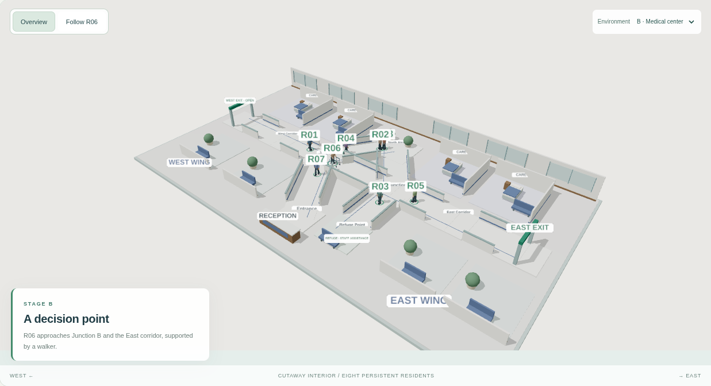
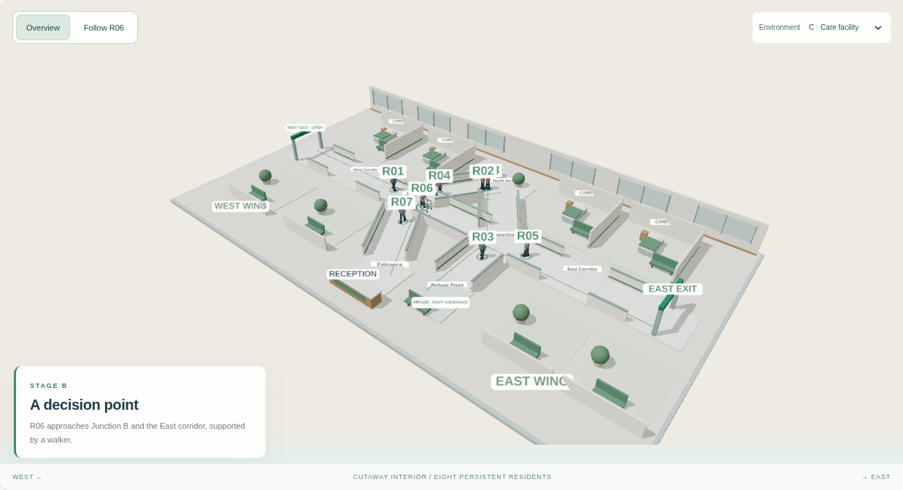

# New Research Paradigm — V2.1-A

**Visual prototype only — scientific logic integration will be completed later.**

A self-contained browser-oriented 3D design package for collaborator and client
review. The prebuilt viewer runs on static hosting; the reusable React / React
Three Fiber source is included for a later engineering handoff. The existing
research application, scientific definitions, intervention controls and frozen
V1 checkpoint are unchanged.

## 1. Scene concept

A modern hospital-like cutaway makes a spatial story readable in a single view:
eight persistent people share the same building; most continue ordinary journeys;
R06, an older adult using a walker, approaches the East side, slows, pauses,
looks around and backtracks. A physical barricade closes East Exit, while West
Exit remains visibly open. R06's status ring becomes critical red. The prototype
ends at this visual long-tail moment; no intervention or scientific decision is
executed.

The clean clinical character comes from patient bays and beds, glazed rear walls,
matte floors, blue-green corridor trim, reception, seating and planters. The front
and corridor walls are cut down so occupants and openings stay visible. East and
West signage, colored wayfinding strips and the refuge seating area are stable
landmarks. This is procedural architecture, not an imported character/building asset.

## 2. Layout and spatial design

Three.js convention: **Y up**, **+X East**, **+Z toward Entrance**, **−Z North**.
Scene units support human-scale drawing proportions; this is not a surveyed or
calibrated building. The floor plate is approximately 45 × 26 drawing units.

| Place | Position [X, Y, Z] | Visual role |
| --- | --- | --- |
| Entrance | [0, 0, 9] | Reception and arrival |
| Junction A | [−5, 0, 0] | First branch after arrival |
| Junction B | [5, 0, 0] | R06's East-side decision area |
| North Atrium | [0, 0, −7] | Glazing, light and planting landmark |
| West Corridor | [−12, 0, 0] | Connection to the accessible exit |
| East Corridor | [12, 0, 0] | Uncertainty / blockage approach |
| West Exit | [−19, 0, 0] | Green OPEN sign throughout |
| East Exit | [19, 0, 0] | Dynamically closed barricade and red X |
| Refuge Point | [5, 0, 8] | Distinct seating / staff-assistance destination |

Arrival goes Entrance → Junction A, then West Corridor / West Exit or Junction B /
East Corridor / East Exit. The atrium reconnects the junctions; Refuge Point is
connected to Junction B. Broad corridor openings and partial walls make those
connections legible. Routes are manually authored visual paths, not pathfinding,
steering, obstacle avoidance or behavioral inference.

## 3. Occupant design

The same **R01–R08** scene objects persist through playback, stage jumps, camera
changes, palette changes and reset. No people are continuously spawned. Residents
have human-like proportions, rounded torsos, heads, articulated hips/knees/arms,
shoes and muted clothing variety. Their floating ID badges are readable in overview;
clicking a person or an ID button opens its visual spotlight.

**R06:** grey hair, glasses, warm neutral cardigan, a modest forward lean, short
scripted steps and an aluminum walker with handles, crossbars and front wheels.
The hand/arm pose stays aligned with the aid. All of these are visual art direction,
not an inferred or empirically validated vulnerability model.

## 4. Motion storyboard

The **48-second visual clock is presentation pacing**, separate from the deployed
research story. Scrub, jump between stages, play, pause and reset for review.
Rendering speed can affect wall-clock playback on slow devices.

| Stage | Visual time | Motion / spatial event | R06 cue |
| --- | --- | --- | --- |
| A — A shared journey | 0–8 | R06 walks from Entrance toward Junction A; other residents move | Green |
| B — A decision point | 8–16 | R06 passes Junction A toward Junction B and the East side | Green |
| C — Uncertainty emerges | 16–24 | Short advances, two holds and a small head look-around | Amber |
| D — A route reconsidered | 24–34 | Two hand-authored backtracks with an intervening forward move / hold | Amber |
| E — East Exit unavailable | 34–40 | Yellow/black barricade and red X appear; R06 cautiously approaches, then holds | Amber |
| F — The long-tail moment | 40–48 | R06 stops with a critical ring; other residents retain their ordinary appearance | Red |

Walking uses alternating leg/arm motion, a small knee bend, gentle body movement
and smoothed facing changes. The walker has a smaller gait amplitude. Head movement,
hesitation, stops and reversals are deterministic keyframes. Reduced motion removes
gait/bobbing and uses discrete positions; the sequence remains inspectable with
stage controls. This does not add cognition, sense of direction, spatial memory,
probabilistic behavior or empirical lostness.

## 5. Camera plan

- **Overview:** elevated oblique cutaway view framing the whole building, residents
  and East/West structure. Default desktop camera [25, 29, 31], looking near the
  building center. A wider mobile camera fits the floor plate.
- **Follow R06:** stable third-person camera offset [−5.4, +4.7, +6.5] from R06.
  It stays on a consistent side of the corridor while the person turns, helping
  viewers understand backtracking and the exit ahead. Exponential interpolation
  softens position / target changes.
- **Reduced motion:** a fixed follow framing replaces continuous camera tracking.
  Overview and storyboard inspection remain available.

## 6. Visual status and stylistic variants

Clothing and skin retain natural colors. A subtle foot ring and ID badge carry
status: **green = ordinary / stable**, **amber = emerging uncertainty**,
**red = critical long-tail case**. The ring eases between colors. These are
narrative labels, not outputs of triage or a safety classifier.

Three material studies share exactly the same geometry, residents and choreography:

| Variant | Palette / character |
| --- | --- |
| A — Modern hospital (default) | Clean off-white, blue-green clinical accents, warm wood |
| B — Medical center | Slate-blue accents, neutral stone and darker timber |
| C — Care facility | Softer sage, warm ivory and light timber |






## 7. Technical output and handoff

```text
v2.1-a/
  browser/                       prebuilt static viewer in the ZIP
    index.html                   no framework server or application backend
    prototype.js                 React + Three.js + R3F, bundled locally
    prototype.css
    THIRD_PARTY_LICENSES.txt
    previews/                    no-WebGL preview and review images
  src/
    Hospital.tsx                 reusable building / room / door geometry
    HumanAvatar.tsx              articulated human and walker
    Label.tsx                    locally drawn label textures
    PrototypeScene.tsx           lights, cameras and visual clock adapter
    PrototypeApp.tsx             authoring controls and visual spotlight
    visualTimeline.ts            locations, palettes, stage / pose keyframes
    main.tsx                     browser mount
    prototype.css
  previews/                      six captured WebGL design renders
  asset-manifest.json
  package.json / package-lock.json
  tsconfig.json / build.mjs
  README.md
```

The Git repository retains source and preview images under `prototypes/v2.1-a/`;
the generated runtime is mirrored at `showcase-web/public/visual-prototype/`.
No existing application source imports this package. The runtime imports no
scientific story, triage, intervention, study-store or provider module. It has no
API, authentication, participant data, server endpoint or persistent browser storage.
No external models, textures, fonts or network services are fetched.

**Open the prebuilt ZIP:** extract it, serve its `browser/` directory with any
static web server, then open that server in a WebGL2-capable browser. For example,
from the extracted `v2.1-a` directory:

```bash
python3 -m http.server 8080 --directory browser
```

This command serves files only; Python is optional and is not an application
backend. Browser `file://` access is subject to local policy and was blocked by
the cloud Chromium administrator, so static hosting is the verified launch method.
Without WebGL the viewer shows the captured local overview.

**Rebuild source independently:** Node 20.9+ (tested with Node 24):

```bash
npm ci
npm run typecheck
npm run build
```

The build writes `browser/`. Inside this repository it also copies static runtime
files to the host public directory, giving the preview path
`/visual-prototype/index.html`; the research landing page stays unchanged. This
is a separately served design sandbox, not scientific integration. No live
Vercel URL was independently verified for this prototype.

For later engineering integration, reuse `Hospital`, `HumanAvatar`, label geometry
and palettes through explicit presentation inputs. Keep the preview clock and its
16/34/40-second art-direction cues separate from the approved scientific model.
Scope the standalone stylesheet or use an iframe before embedding. This handoff
does not define a future intervention policy or connect visual cues to research
measurements.

## 8. Validation and evidence boundary

The prototype typecheck and bundle build pass. Real Chromium / Playwright checks
actual rendered WebGL, eight persistent avatar object identities, playback/pause/
reset, status changes, backtracking, dynamic barrier, cameras, profiles, all three
palettes, reduced-motion/mobile layout, local no-WebGL previews and no external
requests / browser errors / persistent storage. Headless captures use software
WebGL; photorealism and device GPU performance are not claimed.

The existing scientific application and V1 checkpoint remain untouched. No real
human navigation evidence, validated human behavior, sense-of-direction model,
lostness prediction, human-performance estimate or final system behavior is
established. No V2.2, V2.3 or Milestone 7 work is included.

**Visual prototype only — scientific logic integration will be completed later.**
